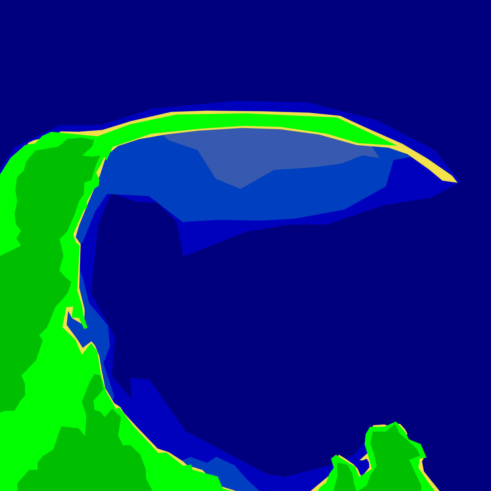
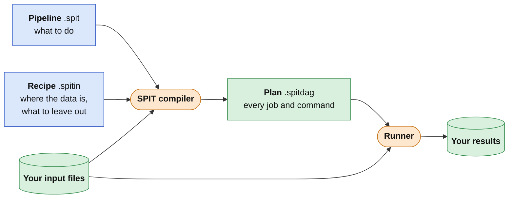

# SPIT — Simple Pipeline in Text



**Describe your pipeline concisely and expressively. Make it repeatable, and keep it maintainable as your inputs and processes change.**

SPIT is a domain-agnostic language for describing data analysis pipelines whose commands can be executed in the command line. The SPIT compiler handles job planning, and the runner handles execution.

SPIT abstracts the pipeline away from the tools and the data. A step is just a command line, so it doesn't matter whether it's `bet`, `bwa`, `ffmpeg` or `python train.py`. If it reads files and writes files, SPIT can plan it.

Reasons to use SPIT:

- Describe the logical flow of data through your system. Let SPIT stitch everything together.
- Catch bugs at compile time in your editor, instead of hours into your processing.
- Separate your input data from the processing. Inputs can change without breaking the pipeline.
- Effortlessly work between and across data dimensions. Additional analysis requires no new implementation.
- Modify your pipeline as you work, and only run the processing that needs to run.
- Elegantly handle CLI arguments. No more hardcoded paths or gymnastics.


## How it works

You write a pipeline (`.spit`) that says what to do, and a recipe (`.spitin`) that says where your data is and what to leave out. `spit` reads both, finds your files, and plans every job into a `.spitdag`. The runner, spit-bash, runs those jobs and keeps track of what's already done.



Blue is what you write, orange is SPIT's tools, and green is files.

## What does writing SPIT look like?

Imagine collecting data from multiple weather sites in multiple regions. Each site logs a file of readings every day, beside a calibration file for its sensor and a file saying where it stands. A file for each kind of alert says when a reading is too cold or too hot:

<!-- spit-doc: plain -->

```text
data/
├── alerts/  frost.json  heat.json
├── north/
│   ├── alder/  calibration.json  site.json  01.csv  02.csv  03.csv
│   └── birch/  calibration.json  site.json  01.csv  02.csv  03.csv
└── south/
    ├── cedar/  calibration.json  site.json  01.csv  02.csv  03.csv
    ├── dune/   calibration.json  site.json  01.csv  02.csv  03.csv
    └── elm/    calibration.json  site.json  01.csv  02.csv  03.csv
```

```spit
# Logic for saving results.
default path: results/[{region}/][{site}/]{@product}[_{alert}][_{day}].csv

# Declare the inputs, and the dimensions they vary by.
source reading : Readings<Raw> [region, site, day]
source calibration : Calibration [region, site]
source location : Site [region, site]
source threshold : Threshold [alert]
# No source holds `alert` beside the others, so say where it goes.
dimensions [region, site, day, alert]

# Define the operations on the data, and commands required.
operation clean(days: many Readings<Raw> @min(2), calibration: Calibration) -> Readings<Clean>
command clean: python clean.py --calibration {calibration} --days {days.day} -o {@output} {days}

operation average(series: many Readings<S>) -> Readings<S>
command average: python average.py -o {@output} {series}

operation reduce(series: Readings<Clean>, location: Site) -> Readings<SeaLevel>
command reduce: python reduce.py --location {location} -o {@output} {series}

operation compare(readings: Readings<SeaLevel>, baseline: Readings<SeaLevel>) -> Anomaly
command compare: python compare.py {readings} {baseline} {@output}

operation rank(anomalies: many Anomaly) -> Table
command rank: python rank.py --sites {anomalies.site} -o {@output} -- {anomalies}

operation tally(series: Readings<Clean>, threshold: Threshold) -> Count
command tally: python tally.py --alert {alert} --threshold {threshold} -o {@output} {series}

# Define the artifacts and data flow
cleaned = clean(reading @vary(day), calibration)
regional = average(cleaned @vary(site))
overall = average(cleaned @vary(region, site))
reduced = reduce(cleaned, location)
regional_reduced = average(reduced @vary(site))
anomaly = compare(reduced, regional_reduced)
league = rank(anomaly @vary(region, site))
alert_days = tally(cleaned, threshold @each(alert))
```

- `default path` says where every output goes, built from the dimensions it has.
- `[region, site, day]` says what each file varies by. Steps join their inputs on the dimensions they share, so each site's readings are cleaned with its own calibration.
- `@vary` says what to gather. `clean(reading @vary(day), calibration)` gathers each site's days into one series, so every step after it runs once per site, not once per file. `@min(2)` says a site needs at least two days.
- One `average` makes three products: each region's temperature with `@vary(site)`, every site's together with `@vary(region, site)`, and each region's at sea level from the reduced series.
- `Readings<Raw>`, `Readings<Clean>` and `Readings<SeaLevel>` are types. `average` takes any of them, written `Readings<S>`, and gives back the same kind. `compare` takes sea-level readings on both sides, so a site is never compared with a region at another height.
- `reduce` takes each site to sea level, so `compare(reduced, regional_reduced)` finds what height doesn't explain: a town, shade, or a hollow that pools cold air.
- `@vary(region, site)` ranks every site in one table, and `{anomalies.site}` lists the sites in the same order as their files.
- `@each(alert)` goes the other way from `@vary`: it repeats a step across a dimension its main input doesn't have. Every site is checked against every alert. Add a `drought.json`, and every site gets checked for drought too.

The pipeline doesn't say where the data is. That goes in a recipe, a `.spitin` file beside the data, so the pipeline stays the same from one dataset to the next. The recipe names the pipeline, the folder the data is in, where each input file lives, and anything to leave out:

<!-- spit-doc: recipe
--- weather.spit
# Logic for saving results.
default path: results/[{region}/][{site}/]{@product}[_{alert}][_{day}].csv

# Declare the inputs, and the dimensions they vary by.
source reading : Readings<Raw> [region, site, day]
source calibration : Calibration [region, site]
source location : Site [region, site]
source threshold : Threshold [alert]
# No source holds `alert` beside the others, so say where it goes.
dimensions [region, site, day, alert]

# Define the operations on the data, and commands required.
operation clean(days: many Readings<Raw> @min(2), calibration: Calibration) -> Readings<Clean>
command clean: python clean.py --calibration {calibration} --days {days.day} -o {@output} {days}

operation average(series: many Readings<S>) -> Readings<S>
command average: python average.py -o {@output} {series}

operation reduce(series: Readings<Clean>, location: Site) -> Readings<SeaLevel>
command reduce: python reduce.py --location {location} -o {@output} {series}

operation compare(readings: Readings<SeaLevel>, baseline: Readings<SeaLevel>) -> Anomaly
command compare: python compare.py {readings} {baseline} {@output}

operation rank(anomalies: many Anomaly) -> Table
command rank: python rank.py --sites {anomalies.site} -o {@output} -- {anomalies}

operation tally(series: Readings<Clean>, threshold: Threshold) -> Count
command tally: python tally.py --alert {alert} --threshold {threshold} -o {@output} {series}

# Define the artifacts and data flow
cleaned = clean(reading @vary(day), calibration)
regional = average(cleaned @vary(site))
overall = average(cleaned @vary(region, site))
reduced = reduce(cleaned, location)
regional_reduced = average(reduced @vary(site))
anomaly = compare(reduced, regional_reduced)
league = rank(anomaly @vary(region, site))
alert_days = tally(cleaned, threshold @each(alert))
-->

```spit
pipeline weather.spit
root data

inputs:
    reading: {region}/{site}/{day}.csv
    calibration: {region}/{site}/calibration.json
    location: {region}/{site}/site.json
    threshold: alerts/{alert}.json

exclude reading[region=south,site=dune,day=02]    # sensor iced over
require [region, site] where calibration count=1
```

`exclude` leaves out a file, and says why. `require` makes sure every site has its calibration file, so a missing one is an error before anything runs.

Run it:

<!-- spit-doc: fragment -->

```sh
spit-bash run weather.spitin -j 4
```

Eight steps become 31 jobs, with output paths defined by `default path`:

<!-- spit-doc: plain -->

```text
results/
├── league.csv
├── overall.csv
├── north/
│   ├── regional.csv  regional_reduced.csv
│   ├── alder/  cleaned.csv  reduced.csv  anomaly.csv  alert_days_frost.csv  alert_days_heat.csv
│   └── birch/  (the same)
└── south/
    ├── regional.csv  regional_reduced.csv
    ├── cedar/  (the same)
    ├── dune/   (the same, cleaned from two days)
    └── elm/    (the same)
```

No loops over regions, sites or days, no list of which site belongs to which region, and no file names. Add a site, a region, a week of days or a kind of alert, and every step that needs it picks it up.

At a larger scale, the same pipeline, with checks and a plotting stage added, follows 16 sites across a mapped landscape for a year and draws this figure. Its 98 jobs run in seconds. The [dataset](https://github.com/eclnz/spit-showcase/raw/main/weather/weather-data.zip) and the [pipeline](https://github.com/eclnz/spit-showcase/tree/main/weather) are in spit-showcase, ready to run:


- **a**, The landscape: the sea to the west, a ridge to the north, and the sites on it, coloured by region. Each site's temperature is built from where it stands: a yearly cycle that swings more inland, a day-night cycle, weather that is partly shared and partly the region's own, and 6.5 °C less for each kilometre of height.
- **b**, What cleaning does to one site's day, chosen because it has both a dropout and a spike. Grey is the sensor as read. Blue is the cleaned day: the readings with the sensor's calibration undone, using the gain and offset from its calibration file, and the two bad hours interpolated from their neighbours. The crosses mark those hours: the dropout at 3 am, and the spike at 9 am, which read 51 °C, off the top of the axis.
- **c**, Each region's daily temperature through the year, the median of its sites, and all sites' together. A median, so that one faulty sensor can't move its region. The coast swings least between winter and summer, and the highland is coldest.
- **d**, How far each site's day is from its own region's, once both are reduced to sea level so that height doesn't count. Red is warmer than the region and blue is colder; grey is a day with no file. Elm is warm all year, sedge is cool, and poppy starts level and turns redder from April.
- **e**, On how many days each site had a frost alert (left) or a heat alert (right), on the same rows as **d**. The highland sites had 29 to 42 frost days; only the valley had heat days.
- **f**, Each site's mean anomaly against its drift, the slope of its anomaly over the year. The shaded band is where a site is not named: within 3.5 robust standard deviations of the median site and, for drift, within the 1 °C a year a sound sensor can wander. Elm, in a town, and sedge, in a hollow that pools cold air, are the place, not the sensor. Poppy has drifted 3.3 °C, which is a sensor going wrong, so it is the one to visit.

## Why SPIT?

**Say what varies, not how to loop.** Name the dimensions your data varies by, and SPIT joins and gathers by them. `@vary(site)` collects each region's sites; `@vary(region, site)` collects every site. The same `average` serves both. `@each(alert)` goes the other way, repeating a step for every alert there is. Nobody writes a loop, a filename pattern or a list of which site belongs where.

**Know exactly what will run, and what can't, before anything does.** Hand-written scripts may not warn you when files are missing, or may crash partway through. SPIT matches the pipeline against your files first. It plans only the combinations that exist, and traces every gap back to the file that's missing. `spit artifacts` lists them all, and `--partial` runs everything that can be made while the rest waits.

**Catch mistakes before they cost you a run.** `spit check` tests types, dimensions, command placeholders and output paths without touching any data, in a few milliseconds, so the editor shows errors as you type. Compare a site's sea-level readings with a region's actual ones, or use a placeholder that has many values in one job, and it points you to the line:

<!-- spit-doc: output
mkdir data
sed 's/anomaly = compare(reduced, regional_reduced)/anomaly = compare(reduced, regional)/' weather.spit > mixed.spit
sed 's/{anomalies.site}/{site}/' weather.spit > typo.spit
spit check mixed.spit || true
spit check typo.spit || true
--- weather.spit
# Logic for saving results.
default path: results/[{region}/][{site}/]{@product}[_{alert}][_{day}].csv

# Declare the inputs, and the dimensions they vary by.
source reading : Readings<Raw> [region, site, day]
source calibration : Calibration [region, site]
source location : Site [region, site]
source threshold : Threshold [alert]
# No source holds `alert` beside the others, so say where it goes.
dimensions [region, site, day, alert]

# Define the operations on the data, and commands required.
operation clean(days: many Readings<Raw> @min(2), calibration: Calibration) -> Readings<Clean>
command clean: python clean.py --calibration {calibration} --days {days.day} -o {@output} {days}

operation average(series: many Readings<S>) -> Readings<S>
command average: python average.py -o {@output} {series}

operation reduce(series: Readings<Clean>, location: Site) -> Readings<SeaLevel>
command reduce: python reduce.py --location {location} -o {@output} {series}

operation compare(readings: Readings<SeaLevel>, baseline: Readings<SeaLevel>) -> Anomaly
command compare: python compare.py {readings} {baseline} {@output}

operation rank(anomalies: many Anomaly) -> Table
command rank: python rank.py --sites {anomalies.site} -o {@output} -- {anomalies}

operation tally(series: Readings<Clean>, threshold: Threshold) -> Count
command tally: python tally.py --alert {alert} --threshold {threshold} -o {@output} {series}

# Define the artifacts and data flow
cleaned = clean(reading @vary(day), calibration)
regional = average(cleaned @vary(site))
overall = average(cleaned @vary(region, site))
reduced = reduce(cleaned, location)
regional_reduced = average(reduced @vary(site))
anomaly = compare(reduced, regional_reduced)
league = rank(anomaly @vary(region, site))
alert_days = tally(cleaned, threshold @each(alert))
-->

```text
error: line 37, column 28: type mismatch at `compare.baseline`: product `regional` is Readings<Clean>, expected Readings<SeaLevel>
error: line 26, column 38: command for `rank` uses `{site}`, but `anomalies` collects `anomaly` across `site` with `@vary(region, site)`, so each job has many values of it; `{anomalies.site}` gives each artifact's, and the jobs of `league` have no dimensions
```

Once it runs, your assumptions are tested where they matter, not discovered three steps later. A `check` tests a file the moment it's read or written, as `@check(nonempty)` or `@check(ndim(3))`, and a `verify` command tests a job's inputs before its command starts. A failing file fails its own job, by name, and nothing downstream runs on it. The runner won't even start while a program or an input is missing.

**Structure that grows with your pipeline.** Each step is one command with declared inputs and outputs, so every stage of the work is a file you can open, check and rerun on its own. Steps that belong together become one operation the pipeline calls as a single step, and `use` shares it between pipelines. A `stage` groups a phase of work, with its own output folder and its own default checks. Types are there when you want them: the example's `Readings<Clean>` and `Readings<SeaLevel>` are what made comparing a site with a region at another height an error above. Start without them, add them where a mistake would cost you, and switch on `types strict` once the pipeline settles.

**One pipeline, many datasets, every exclusion explained.** Which files to read, what to leave out and how much each group must have go in a recipe (`.spitin`) beside the data. Each `exclude` carries its reason, and `require` makes a gap an error rather than a surprise. For quality control by eye, a `review` reads pass and fail verdicts from a spreadsheet, and holds back whatever hasn't passed.

**Never write a path again.** One `default path` names every output from its dimensions, with optional parts for the dimensions a product doesn't have. Commands get paths, not path-building code.

**A runner that comes with it.** [spit-bash](runner/README.md), in this repository, runs the plan in parallel on your machine and remembers what each job read, ran and wrote:

- Add data or edit a command, and only the jobs it affects rerun. If a rerun gives the same output as before, everything after it is kept.
- Files are compared by content, so `touch`, a fresh checkout or a moved dataset reruns nothing.
- A failed job never leaves a half-written file behind: its outputs are removed and the previous version is put back. Its log holds every command it ran, ready to run by hand.
- `spit-bash plan` says what will run, and why, before anything does. Every replaced output is kept, and `spit-bash restore` puts it back.

The plan itself is a file in a [documented format](docs/spitdag.md), so another runner, for a cluster or the cloud, needs nothing else.

**Is it for you?** SPIT fits work where command-line tools run over many files, each step reading files and writing files. It isn't a fit when:

- you need a cluster or the cloud today: spit-bash runs on one machine, and other runners don't exist yet;
- steps are Python functions passing data in memory, or read from databases or streams;
- what runs next depends on what a step finds: the plan is fixed before anything runs.

## Install

You'll need the [Rust toolchain](https://www.rust-lang.org/tools/install) for SPIT, and Python 3.10 or newer for spit-bash:

<!-- spit-doc: fragment -->

```sh
cargo install --git https://github.com/eclnz/spit --branch dev spit
python3 -m pip install "git+https://github.com/eclnz/spit@dev#subdirectory=runner"
```

Then check, plan and run your pipeline:

<!-- spit-doc: fragment -->

```sh
spit check weather.spit             # check the pipeline without reading any data
spit dag weather.spitin --counts    # count the jobs for each step
spit-bash run weather.spitin -j 4   # run them, four at a time
```

Install the [VS Code extension](https://github.com/eclnz/spit-vscode) to see errors as you type. Hover over any product to see its type, dimensions, command and output path.

## Learn more

- New to SPIT? [Getting started](docs/getting-started.md) walks you through a pipeline in this repository.
- [The guide](docs/guide/concepts.md) covers pipelines, matching, paths, recipes, and how to find out why a job is missing.
- [Examples](docs/examples.md) include a ragged parameter sweep and a cohort with missing inputs.
- [spit-showcase](https://github.com/eclnz/spit-showcase) has the weather network above, and pipelines on public data from unrelated fields: spoken-digit audio, MRI, SARS-CoV-2 variant calling, elevation tiles and scikit-learn models.
- For the details, see the [language manual](docs/language-reference.md), the [command line](docs/cli.md) and the [DAG format](docs/spitdag.md).

To browse the docs as a site, install [uv](https://docs.astral.sh/uv/) and run `uv run properdocs serve`.

## Contributing

Issues and pull requests are welcome. Start with [the architecture map](docs/architecture.md) to see how the compiler fits together, and [AGENTS.md](AGENTS.md) for the code rules and the checks to run before you commit.

## Disclaimer

SPIT was built with the help of generative AI. I'm not a Rust developer: AI wrote most of the code and docs, and I've checked it by testing how it behaves, not by expert review of the Rust. The tests cover the examples and language features, but the code may still have bugs or unidiomatic Rust. The commands in a `.spitdag` run on your system, so review them before you run them, especially on data you can't easily replace. The software is provided as is, without warranty of any kind; see the [license](LICENSE).

## License

SPIT is released under the [MIT License](LICENSE).


Collections can reach tools as separate arguments (`{xs}`), one joined argument
(`@join(xs, ",")`), or a temporary list file (`@list(xs)`). A source ending in
`here` makes a pipeline-local script a tracked input. Tool environment files
(`tools from host.spitenv`) and `anchored` operations declare additional reasons
to rerun. See the [language reference](docs/language-reference.md#collection-arguments)
and the [runnable collection example](examples/runnable/collections/collections.spitin).
