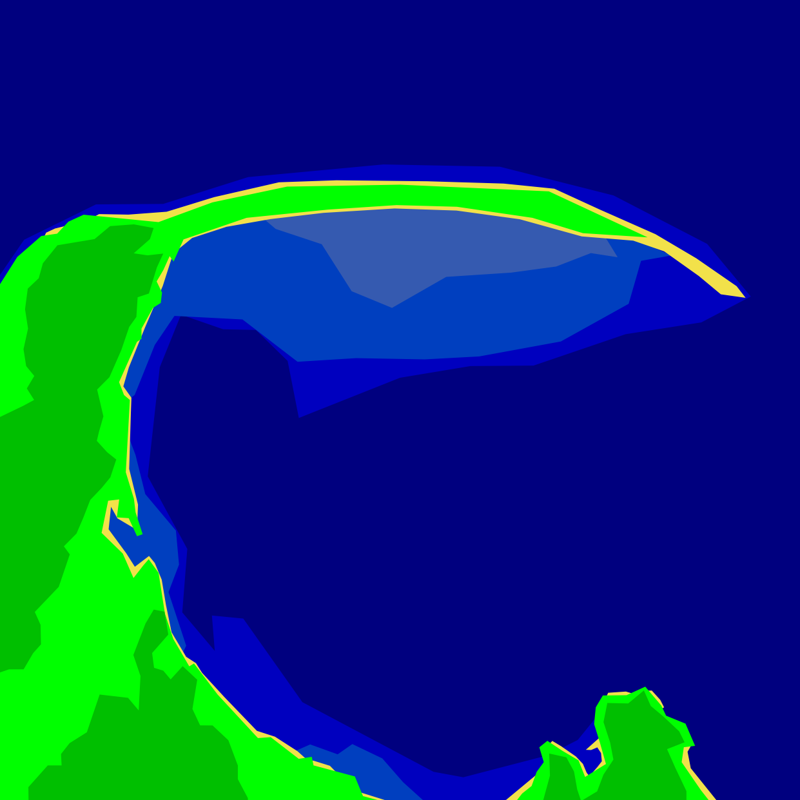

# SPIT — Simple Pipeline in Text



SPIT is a language and compiler for building data pipelines from command-line tools. It works out which files belong together and which jobs to run when you apply the same analysis across many samples, sites, or days.

In a pipeline, you describe what each step reads and produces, the command it runs, and how the files are organised. Dimensions such as `site` and `day` give SPIT the information it needs to match inputs, repeat steps, and gather results.

Point the pipeline at a dataset and SPIT produces a plan with the jobs, their dependencies, and the exact commands. Inspect the plan before handing it to `spit-bash` to run.

## What it looks like

A weather network has several stations in each region. Each station writes one readings file per day and has its own calibration file. The goal is one temperature series per region. To get there, clean each station’s readings with its calibration, then combine the cleaned series from the stations in that region.

<!-- spit-doc: setup
default path: [{region}/][{site}/]{@product}[_{day}].csv
operation clean(days: many Readings<Raw> @min(2), calibration: Calibration) -> Readings<Clean>
command clean: python3 clean.py --calibration {calibration} --days {days.day} -o {@output} {days}
operation average(series: many Readings<S>) -> Readings<S>
command average: python3 average.py -o {@output} {series}
-->

```spit
source reading : Readings<Raw> [region, site, day]
source calibration : Calibration [region, site]

cleaned = clean(reading @vary(day), calibration)
regional = average(cleaned @vary(site))
```

`@vary(day)` gathers each station’s daily files. SPIT matches its calibration on `region` and `site`. `@vary(site)` then gathers the cleaned station series within each region. The `average` operation computes an hourly median.

[Run the weather example](https://github.com/eclnz/spit-showcase/tree/main/weather)

## What you can do

- **Reuse the same pipeline across datasets.** A recipe supplies data paths, exclusions, and coverage requirements.
- **Inspect the plan before running it.** See the jobs, inputs, and commands, and trace missing outputs to their causes.
- **Catch wiring mistakes early.** Declare types at the boundaries you want SPIT to check.
- **Reuse current outputs.** `spit-bash` skips jobs whose work is still current and reruns jobs when their inputs or commands change.

## Install

Install the compiler with Rust’s Cargo and the runner in a Python 3.10 or newer environment.

<!-- spit-doc: fragment -->

```sh
cargo install --git https://github.com/eclnz/spit --branch dev spit
python3 -m pip install "git+https://github.com/eclnz/spit@dev#subdirectory=runner"
```

## Documentation

- [Getting started](docs/getting-started.md)
- [Language guide](docs/guide/concepts.md)
- [Language reference](docs/language-reference.md)

## Contributing

Issues and pull requests are welcome. Start with [the architecture map](docs/architecture.md) to see how the compiler fits together, and [AGENTS.md](AGENTS.md) for the code rules and the checks to run before you commit.

## Disclaimer

SPIT was built with the help of generative AI. I'm not a Rust developer: AI wrote most of the code and docs, and I've checked it by testing how it behaves, not by expert review of the Rust. The tests cover the examples and language features, but the code may still have bugs or unidiomatic Rust. The commands in a `.spitdag` run on your system, so review them before you run them, especially on data you can't easily replace. The software is provided as is, without warranty of any kind; see the [license](LICENSE).

## License

SPIT is released under the [MIT License](LICENSE).
