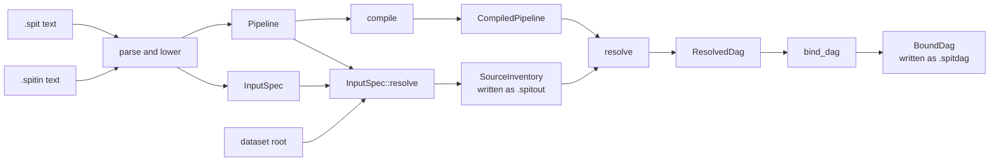

# Architecture

SPIT is a compiler, and this part of the documentation describes how it works, for contributors. Each stage takes data and returns data. The [guide](guide/concepts.md) describes the same flow from the user's side, and [AGENTS.md](https://github.com/eclnz/spit/blob/dev/AGENTS.md) holds the rules for changing the code.

A runner reads only the `.spitdag`. SPIT defines the graph, and the runner carries out its commands and checks.

Each page describes one contract:

- [Parsing and lowering](architecture/parsing.md): text to a `Pipeline` or an `InputSpec`, with every error the text has.
- [Inputs](architecture/inputs.md): a recipe, a pipeline and a dataset to a `SourceInventory`.
- [Resolution](architecture/resolution.md): a `Pipeline` and a `SourceInventory` to a `ResolvedDag`, or an `ArtifactReport` of what cannot be made.
- [Binding and output](architecture/binding.md): a `ResolvedDag` to a `BoundDag`, with each artifact's path and each job's commands.
- [Diagnostics and the editor](architecture/diagnostics.md): every stage's errors and warnings as one list, and the editor's hovers.
- [Performance](architecture/performance.md): the data-layout rules that keep each stage in step with its input.
- [Extending SPIT](architecture/extending.md): where a new feature enters, and what it must keep.

## Boundaries

- **Three steps stay apart.** `compile`, `inputs` and the resolver (`resolver`, `render`) reach into each other only in one direction: inputs may use compile, the resolver may use compile, and neither may use the other. The command line, the editor and `src/diagnostics` may use every step. Test: [`step_modules_do_not_import_later_steps`](https://github.com/eclnz/spit/blob/dev/tests/architecture.rs).
- **The model is shared.** `src/model` holds the data every step reads: `Pipeline`, `InputRules`, `SourceInventory`, `ResolvedDag` and the `Artifacts` table.
- **The library's API is what `src/lib.rs` re-exports.** Every module is private.
- **No domain knowledge.** The examples use imaging names, but `src/` holds no imaging types, operations or assumptions.
