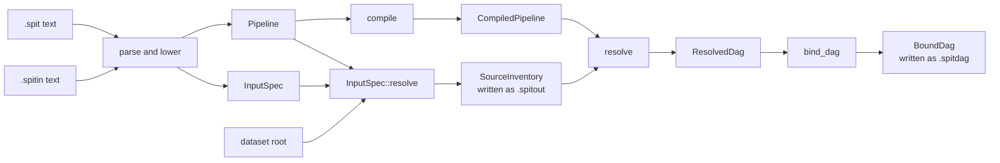

# Architecture

SPIT is a compiler, and this part of the documentation describes how it works, for contributors. Each stage takes data and returns data. The [guide](guide/concepts.md) describes the same flow from the user's side, and [AGENTS.md](https://github.com/eclnz/spit/blob/dev/AGENTS.md) holds the rules for changing the code.

A runner reads only the `.spitdag`. SPIT defines the graph, and the runner carries out its commands and checks.

Each page describes one contract:

- [Parsing and lowering](architecture/parsing.md): text to a `Pipeline` or an `InputSpec`, with every error the text has.
- [Inputs](architecture/inputs.md): a recipe, a pipeline and a dataset to a `SourceInventory`.
- [Resolution](architecture/resolution.md): a `Pipeline` and a `SourceInventory` to a `ResolvedDag`, or an `ArtifactReport` of what cannot be made.
- [Binding and output](architecture/binding.md): a `ResolvedDag` to a `BoundDag`, with each artifact's path and each job's commands.
- [Diagnostics and the editor](architecture/diagnostics.md): every stage's errors and warnings as one list, and the editor's hovers.
- [Performance](architecture/performance.md): the data-layout rules that keep each stage in step with its input.
- [Extending SPIT](architecture/extending.md): where a new feature enters, and what it must keep.

## Boundaries

- **Five stages, three commands.** The diagram's stages are parsing (`parse and lower`), checking (`compile`, with validation of the input rules), inputs (`InputSpec::resolve`), resolution (`resolve`) and binding (`bind_dag`). The command line runs them in three steps:
  - `spit check` parses and checks a pipeline, and validates a recipe's input rules against it.
  - `spit inputs` adds the inputs stage, and writes the `SourceInventory` as a `.spitout`.
  - `spit dag` adds resolution and binding, and writes the `BoundDag` as a `.spitdag`. `spit artifacts` stops after resolution, and reports what cannot be made.
- **Every module has a layer, and uses only its own and those below.** From the bottom, the layers are values (`span`, `types`, `template`, `json`, `blob`), the model (`model`, `shape`), parsing (`parser`, `lower`, `order`, `builtins`), checking (`compile`, `check`, `command`, `paths`, `resources`, `review`), inputs (`inputs`) and resolution (`resolver`) side by side, binding and output (`bind`, `spitdag`, `render`), validation (`validate`), which checks a pipeline with its input rules and so uses inputs but neither resolution nor binding, and the drivers: the command line, the editor, `src/diagnostics` and `src/lib.rs`, which may use every layer. Inputs and resolution do not use each other, and two modules in one layer do not use each other both ways. Test: [`modules_use_only_their_layer_and_below`](https://github.com/eclnz/spit/blob/dev/tests/architecture.rs).
- **The model is shared.** `src/model` holds the data every step reads: `Pipeline`, `InputRules`, `SourceInventory`, `ResolvedDag` and the `Artifacts` table.
- **The library's API is what `src/lib.rs` re-exports.** Every module is private.
- **No domain knowledge.** The examples use imaging names, but `src/` holds no imaging types, operations or assumptions.
