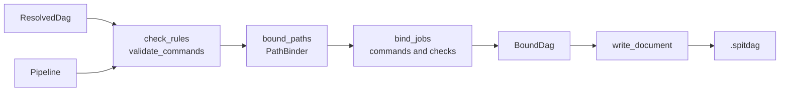

# Binding and output

Binding turns a `ResolvedDag`, which holds logical artifacts and jobs, into a `BoundDag`, which a runner can carry out with no pipeline. It gives each artifact its path from the path rules, and expands each job's commands and checks into arguments. [The DAG format](../spitdag.md) owns the `.spitdag` file this writes, field by field; this page covers how SPIT builds it.

## Data

- **`bind_dag(&pipeline, &dag)`** ([`src/resolver/bind.rs`](https://github.com/eclnz/spit/blob/dev/src/resolver/bind.rs)) gives the `BoundDag`. `bind_dag_with` takes paths that `validate_bound_source_files` already bound, so `dag` with a root binds them once.
- **`BoundDag`** ([`src/spitdag/mod.rs`](https://github.com/eclnz/spit/blob/dev/src/spitdag/mod.rs)) keeps:
    - the same `Artifacts` table as the `ResolvedDag`, with each artifact's path as a column by id;
    - each product's dimensions, and whether its artifacts are folders, once per product;
    - the steps (`BoundStep`), each with its port names, so a job's inputs and outputs are artifact ids in port order, and the `Resources` each of its jobs needs;
    - the jobs (`BoundJob`), each with its `BoundCommand`s, one for each line of its operation's command: an `Argument` list of `ArgPart`s, and the artifacts its `stdin` and `stdout` are connected to;
    - what was removed and left out, the pipeline's files, and the calls.
- **`PathTemplate`** ([`src/paths/template.rs`](https://github.com/eclnz/spit/blob/dev/src/paths/template.rs)) is a rule's text read into parts. `PipelineIndex::path_template_for` completes a product's rule:
    - its `[...]` groups kept or dropped for the product's dimensions and stage;
    - `{@entities}` written out, as the nearest `default entities:` spells it;
    - its extension added: an operation's output extension, a source's declared one, or else `default ext:`.
- **`PathBinder`** ([`src/paths/product.rs`](https://github.com/eclnz/spit/blob/dev/src/paths/product.rs)) binds artifacts to paths. `PathBinder::bind_numbered` finds each product's template and stage once, by its number in the artifact table.
- **`CommandTemplate`** ([`src/command/mod.rs`](https://github.com/eclnz/spit/blob/dev/src/command/mod.rs)) is a command's arguments, each literal text and `{placeholders}`, and its `Redirect`s: each `<` or `>` word with the word after it, which are not arguments.
- **`write_document`** ([`src/spitdag/write.rs`](https://github.com/eclnz/spit/blob/dev/src/spitdag/write.rs)) writes each artifact's JSON once, and hashes each job's fingerprint from its work, which `write_work_commands` ([`src/spitdag/work.rs`](https://github.com/eclnz/spit/blob/dev/src/spitdag/work.rs)) writes a job's commands into.

## Responsibilities

**Paths** ([`src/paths`](https://github.com/eclnz/spit/tree/dev/src/paths)):

- **Every step sees the same completed template for a product.** Binding, discovery and the extension checks all read it from `PipelineIndex::path_template_for`.
- **Where a product's rule comes from.** `PipelineIndex::path_origin` is the one place that chooses, in this order:
    1. the product's own rule;
    2. its stage's default, or that of the nearest stage around it with one;
    3. the pipeline's `default path:`.

    A pipeline default that needs `{@stage}` outside a group is no source's rule, since no stage makes a source. Nor is one that needs `{@entities}` outside a group the rule of a source with no dimensions.
- **A companion source's path follows its main source.** That holds for an output a tool writes beside another too (`PipelineIndex::beside`, which gives a `BesideFile`), and when a recipe supplies the main source's rule. The suffix replaces the sibling's extension, or with `Beside::append` follows its whole name.
- **An output beside an input follows that input's bound file.** `bound_paths` ([`src/paths/bind.rs`](https://github.com/eclnz/spit/blob/dev/src/paths/bind.rs)) binds it after every other artifact, from the path of the job's artifact at that input (`beside_path`), so it follows a source's discovered file as well as a rule. `PipelineIndex::path_template_for` gives the same path as a template, with the sibling's `{@product}`, `{@stage}` and the values the step pins written out, for the rule checks, discovery and the editor. `check_beside_inputs` ([`src/compile/steps.rs`](https://github.com/eclnz/spit/blob/dev/src/compile/steps.rs)) makes sure each job reads its own artifact there. Tests: [`an_output_beside_a_source_lies_beside_its_file_and_its_reader_waits_for_it`](https://github.com/eclnz/spit/blob/dev/tests/beside_inputs.rs), [`the_input_an_output_is_written_beside_gives_each_job_its_own_file`](https://github.com/eclnz/spit/blob/dev/tests/beside_inputs.rs).
- **A recipe can give a source with no rule one.** It gives its own `path source:` rule, or else its `default path:`. `InputRules` keeps the recipe as written, `InputRules::source_paths_for` gives the rule for each source, and the input stage merges them into the inventory.
- **`{@entities}` is spelled by an `EntitiesFormat`.** One may come from the file (`Pipeline::entities_format`), a stage (`StageDef::entities_format`) or a recipe (`InputRules::source_entities`). `PipelineIndex::entities_format_for` finds a product's spelling, and `PathTemplate::resolve` expands it into literal keys and ordinary placeholders once per product, so binding and discovery never see it.
- **A placeholder in a source rule may take a shape,** as in `{date:date}` (`Shape`, in [`src/paths/shape.rs`](https://github.com/eclnz/spit/blob/dev/src/paths/shape.rs)). Shapes narrow matching only. `collect_paths` rejects a shape in a rule that writes: an output's rule, or a pipeline or stage default.
- **Rules are checked before any job exists.** `inspect_paths` and `collect_paths` ([`src/paths/rules.rs`](https://github.com/eclnz/spit/blob/dev/src/paths/rules.rs)) report:
    - a rule ending in another extension;
    - a dimension outside a group that the product lacks;
    - a group naming a dimension no product has;
    - an output no rule covers, at its declaration.

    They also bind a sample artifact of every product, which fails for a product whose `{@entities}` or `{@stage}` cannot be written (`unspelled_entities`).

**Commands and checks:**

- **A placeholder names a port, or else a dimension.** `slot` looks a name up among the operation's ports first, so a port shadows a dimension of the same name. `{x.dir}` and `{x.stem}` give an output's folder, and its file name without its extension. A `many` port expands into one argument per artifact, in the collection's order, so its placeholder must fill a whole argument.
- **A dimension's placeholder is the job's value, as text.** Any other name is `Slot::Dimension`. `collect_commands` ([`src/command/validate.rs`](https://github.com/eclnz/spit/blob/dev/src/command/validate.rs)) checks it against each step calling the operation, by the dimensions of the product the step's first output makes, and so before any data is read; an operation no step calls is not checked. `expand` reads the value from the entities of the job's first output, which carry each of its step's dimensions, and writes it as an `ArgPart::Text` within its argument. Tests: [`a_command_and_its_verify_are_given_the_jobs_values_as_text`](https://github.com/eclnz/spit/blob/dev/tests/command_dimensions.rs), [`a_dimension_the_jobs_lack_is_an_error_at_the_placeholder`](https://github.com/eclnz/spit/blob/dev/tests/command_dimensions.rs).
- **An input's `{port.dimension}` is each of its artifacts' value.** `facet` reads any part after the `.` but `dir` and `stem` as `Facet::Dimension`. `collect_commands` checks that the product each calling step binds to the port has the dimension. `expand` writes a many input's as one `ArgPart::Text` argument per artifact, in the order of the port's paths, and a one input's within its argument. Test: [`a_many_input_gives_each_artifacts_value_in_the_order_of_its_paths`](https://github.com/eclnz/spit/blob/dev/tests/command_dimensions.rs).
- **A command's lines are its `CommandDef::lines`.** `parse_command` ([`src/parser/command.rs`](https://github.com/eclnz/spit/blob/dev/src/parser/command.rs)) reads a `command` with nothing after its `:` as one `CommandTemplate` per line beneath it, and every other command as one. `check_command_placeholders` checks every line against the operation, and the outputs they use between them; `bind_job` expands each line into a `BoundCommand`. Test: [`a_job_runs_each_line_as_a_command_of_its_own`](https://github.com/eclnz/spit/blob/dev/tests/command_sequences.rs).
- **A `verify` command uses the same placeholders,** with inputs as its only ports.
- **`{@cores}` is a number, not a port.** `slot` gives it as `Slot::Cores`, and `expand` writes the step's cores as text, from its operation's `ResourcesDef`, or 1 without one. `collect_resources` ([`src/resources.rs`](https://github.com/eclnz/spit/blob/dev/src/resources.rs)) checks that each `resources` line names an operation with no body, once.
- **Each bare shell operator word is rejected,** such as `|` or `>>`, at its column. A runner runs a command without a shell, so `CommandTemplate::parse` marks those words. A quoted one is literal text.
- **A bare `<` or `>` word connects a stream to a port.** `CommandTemplate::parse` takes it and the word after it out of the arguments as a `Redirect`. The parser (`check_redirects`) allows them only in an operation's command, once each in a line, each followed by one placeholder, and a `>` in one line of a command at most; `validate_commands` checks that `>` names an output that is a file, which no argument of its line or a line before it names, and `<` a `one` input. `bind_job` turns them into each `BoundCommand`'s `stdin` and `stdout` artifacts, and rejects a folder on stdin.
- **A check is its own small model.** `CheckDef` is a check declaration, and `CheckUse` its use on an input port, an output port or a source. `src/check.rs` validates them, and at binding gives each step its checks once (`step_checks`) and each job one command per checked artifact.
- **Commands and checks change no job, path, dependency or fingerprint.** Nor does what a job needs: `cores` and `memory` are written from the step, outside the fingerprint's JSON.

**`spit dag --paths`** shows each job's named inputs and outputs and their paths: the `.spitdag` without its commands.

## Invariants

- **The output is the same bytes for the same pipeline, inventory, root and SPIT version.** It never depends on hash order (AGENTS.md says how the code keeps to that). Test: [`tests/outputs.rs`](https://github.com/eclnz/spit/blob/dev/tests/outputs.rs), which compares every example's output with a stored copy under `tests/fixtures/outputs/`.
- **No two artifacts share a path.** Products whose rules give the same path for the same entities are an error. Tests: [`path_rule_errors_point_to_the_rule_in_use`](https://github.com/eclnz/spit/blob/dev/tests/diagnostics.rs), [`two_sources_with_one_dimension_name_collide_whatever_their_shapes`](https://github.com/eclnz/spit/blob/dev/tests/placeholder_shapes.rs).
- **SPIT writes no path of its own.** An output with no rule fails at its declaration. A source with records but no rule fails at binding, rather than being looked for under `out/`. Tests: [`an_output_with_no_rule_is_an_error_and_a_source_waits_for_one`](https://github.com/eclnz/spit/blob/dev/tests/paths.rs), [`a_recorded_source_with_no_path_rule_is_not_looked_for_under_out`](https://github.com/eclnz/spit/blob/dev/tests/cli.rs).
- **Checks change neither the jobs nor their fingerprints.** Test: [`checks_change_neither_the_jobs_nor_their_fingerprints`](https://github.com/eclnz/spit/blob/dev/tests/checks.rs).
- **A job with one command keeps the fingerprint a single command gave it.** Test: [`a_job_with_one_command_hashes_as_a_job_with_a_single_command_did`](https://github.com/eclnz/spit/blob/dev/src/spitdag/write.rs).
- **What a job needs leaves its fingerprint as it is.** Test: [`resources_leave_the_fingerprint_unless_the_command_uses_them`](https://github.com/eclnz/spit/blob/dev/tests/resources.rs).
- **A dimension's value is in the fingerprint as the text it gives the command.** Test: [`a_value_joins_the_fingerprint_as_the_same_text_written_out_would`](https://github.com/eclnz/spit/blob/dev/tests/command_dimensions.rs).

A `.spitdag` belongs to the inventory it was made from: a new inventory needs a new `dag`.

## Failure

- Every failure comes before the `.spitdag` is written: an unknown placeholder, a path collision, an embedded `many` expansion, or a rule that cannot be bound. Each is a `BindError`, made from a `PathError` or a `CommandError`.
- With a dataset root, `dag` and `artifacts` also check that each source file the DAG needs exists under it (`validate_bound_source_files`). Output paths are checked as paths, but are not expected to exist before the run.
