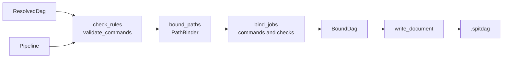

# Binding and output

Binding turns a `ResolvedDag`, which holds logical artifacts and jobs, into a `BoundDag`, which a runner can carry out with no pipeline. It gives each artifact its path from the path rules, and expands each job's commands and checks into arguments. [The DAG format](../spitdag.md) owns the `.spitdag` file this writes, field by field; this page covers how SPIT builds it.

## Data

- **`bind_dag(&pipeline, &dag)`** ([`src/resolver/bind.rs`](https://github.com/eclnz/spit/blob/dev/src/resolver/bind.rs)) gives the `BoundDag`. `bind_dag_with` takes paths that `validate_bound_source_files` already bound, so `dag` with a root binds them once.
- **`BoundDag`** ([`src/spitdag/mod.rs`](https://github.com/eclnz/spit/blob/dev/src/spitdag/mod.rs)) keeps:
    - the same `Artifacts` table as the `ResolvedDag`, with each artifact's path as a column by id;
    - each product's dimensions, and whether its artifacts are folders, once per product;
    - the steps (`BoundStep`), each with its port names, so a job's inputs and outputs are artifact ids in port order;
    - the jobs (`BoundJob`), with each command an `Argument` list of `ArgPart`s;
    - what was removed and left out, the pipeline's files, and the calls.
- **`PathTemplate`** ([`src/paths/template.rs`](https://github.com/eclnz/spit/blob/dev/src/paths/template.rs)) is a rule's text read into parts. `PipelineIndex::path_template_for` completes a product's rule:
    - its `[...]` groups kept or dropped for the product's dimensions and stage;
    - `{@entities}` written out, as the nearest `default entities:` spells it;
    - its extension added: an operation's output extension, a source's declared one, or else `default ext:`.
- **`PathBinder`** ([`src/paths/product.rs`](https://github.com/eclnz/spit/blob/dev/src/paths/product.rs)) binds artifacts to paths. `PathBinder::bind_numbered` finds each product's template and stage once, by its number in the artifact table.
- **`CommandTemplate`** ([`src/command.rs`](https://github.com/eclnz/spit/blob/dev/src/command.rs)) is a command's arguments, each literal text and `{placeholders}`.
- **`write_document`** ([`src/spitdag/write.rs`](https://github.com/eclnz/spit/blob/dev/src/spitdag/write.rs)) writes each artifact's JSON once, and hashes each job's fingerprint from its work.

## Responsibilities

**Paths** ([`src/paths`](https://github.com/eclnz/spit/tree/dev/src/paths)):

- **Every step sees the same completed template for a product.** Binding, discovery and the extension checks all read it from `PipelineIndex::path_template_for`.
- **Where a product's rule comes from.** `PipelineIndex::path_origin` is the one place that chooses, in this order:
    1. the product's own rule;
    2. its stage's default, or that of the nearest stage around it with one;
    3. the pipeline's `default path:`.

    A pipeline default that needs `{@stage}` outside a group is no source's rule, since no stage makes a source. Nor is one that needs `{@entities}` outside a group the rule of a source with no dimensions.
- **A companion source's path follows its main source.** That holds for an output a tool writes beside another too (`PipelineIndex::beside`), and when a recipe supplies the main source's rule.
- **A recipe can give a source with no rule one.** It gives its own `path source:` rule, or else its `default path:`. `InputRules` keeps the recipe as written, `InputRules::source_paths_for` gives the rule for each source, and the input stage merges them into the inventory.
- **`{@entities}` is spelled by an `EntitiesFormat`.** One may come from the file (`Pipeline::entities_format`), a stage (`StageDef::entities_format`) or a recipe (`InputRules::source_entities`). `PipelineIndex::entities_format_for` finds a product's spelling, and `PathTemplate::resolve` expands it into literal keys and ordinary placeholders once per product, so binding and discovery never see it.
- **A placeholder in a source rule may take a shape,** as in `{date:date}` (`Shape`, in [`src/paths/shape.rs`](https://github.com/eclnz/spit/blob/dev/src/paths/shape.rs)). Shapes narrow matching only. `collect_paths` rejects a shape in a rule that writes: an output's rule, or a pipeline or stage default.
- **Rules are checked before any job exists.** `inspect_paths` and `collect_paths` ([`src/paths/rules.rs`](https://github.com/eclnz/spit/blob/dev/src/paths/rules.rs)) report:
    - a rule ending in another extension;
    - a dimension outside a group that the product lacks;
    - a group naming a dimension no product has;
    - an output no rule covers, at its declaration.

    They also bind a sample artifact of every product, which fails for a product whose `{@entities}` or `{@stage}` cannot be written (`unspelled_entities`).

**Commands and checks:**

- **Each placeholder names a port.** `{x.dir}` and `{x.stem}` give an output's folder, and its file name without its extension. A `many` port expands into one argument per artifact, in the collection's order, so its placeholder must fill a whole argument.
- **A `verify` command uses the same placeholders,** for inputs only.
- **Each bare shell operator word is rejected,** such as `|` or `>`, at its column. A runner runs a command without a shell, so `CommandTemplate::parse` marks those words. A quoted one is literal text.
- **A check is its own small model.** `CheckDef` is a check declaration, and `CheckUse` its use on an input port, an output port or a source. `src/check.rs` validates them, and at binding gives each step its checks once (`step_checks`) and each job one command per checked artifact.
- **Commands and checks change no job, path, dependency or fingerprint.**

**`spit dag --paths`** shows each job's named inputs and outputs and their paths: the `.spitdag` without its commands.

## Invariants

- **The output is the same bytes for the same pipeline, inventory, root and SPIT version.** It never depends on hash order (see AGENTS.md). Stored outputs under `tests/fixtures/outputs/` check it (`tests/outputs.rs`).
- **No two outputs share a path.** `dag` checks collisions among concrete paths.
- **SPIT writes no path of its own.** An output with no rule fails at its declaration. A source with records but no rule fails at binding, rather than being looked for under `out/`.
- **What every job of a step shares is kept once.** Binding finds each step's operation, commands and checks once, not once per job.
- **A `.spitdag` belongs to one inventory.** A new inventory needs a new `dag`.

The tests are `tests/paths.rs`, `tests/extensions.rs`, `tests/entities_format.rs`, `tests/placeholder_shapes.rs`, `tests/folder_and_stem.rs`, `tests/folders.rs`, `tests/beside.rs`, `tests/commands.rs`, `tests/checks.rs`, `tests/default_checks.rs` and `tests/outputs.rs`.

## Failure

- Every failure comes before the `.spitdag` is written: an unknown placeholder, a path collision, an embedded `many` expansion, or a rule that cannot be bound. Each is a `BindError`, made from a `PathError` or a `CommandError`.
- With a dataset root, `dag` and `artifacts` also check that each source file the DAG needs exists under it (`validate_bound_source_files`). Output paths are checked as paths, but are not expected to exist before the run.
