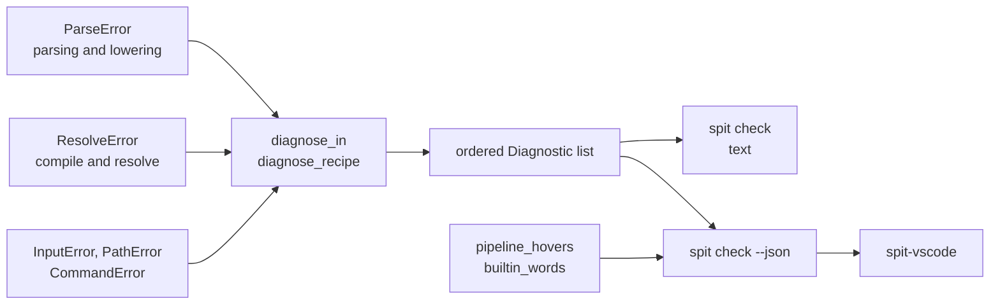

# Diagnostics and the editor

Every stage reports a problem as data: an error enum whose fields say what went wrong, and a place that says where. `src/diagnostics` turns those errors into one ordered list of `Diagnostic`s. It decides each one's severity once, and the command line and the editor both read that list. The editor's hovers are built beside it, from the same parse.

## Data

- **`Diagnostic`** ([`src/diagnostics/diagnostic.rs`](https://github.com/eclnz/spit/blob/dev/src/diagnostics/diagnostic.rs)) has:
    - its `Severity`, `Error` or `Warning`;
    - its source, the document or its inventory;
    - its line and byte columns, and the file, when another file holds the problem;
    - its message.
- **`diagnose_in`** and the other `diagnose_*` functions ([`src/diagnostics/mod.rs`](https://github.com/eclnz/spit/blob/dev/src/diagnostics/mod.rs)) check a pipeline. **`diagnose_recipe`** ([`src/diagnostics/recipe.rs`](https://github.com/eclnz/spit/blob/dev/src/diagnostics/recipe.rs)) checks a recipe. Each parses with recovery (see [parsing](parsing.md)), and checks the semantics once the document parses. It resolves jobs against an inventory only once nothing else is wrong.
- **Warnings** come from [`src/diagnostics/warnings.rs`](https://github.com/eclnz/spit/blob/dev/src/diagnostics/warnings.rs).
- **Places** come from [`src/diagnostics/places.rs`](https://github.com/eclnz/spit/blob/dev/src/diagnostics/places.rs):
    - `in_call` places an error about a step that a call made. It points at the call written in the text, and at the argument when the failing port reads one of the call's inputs. Each nested call and the body step are `Related` places, each with its own line's text from `SourceMap::file_texts`.
    - `at_call` places an error about a call itself, in the same way, without a body step.
- **Hovers** are made by `pipeline_hovers` ([`src/editor.rs`](https://github.com/eclnz/spit/blob/dev/src/editor.rs)) for a pipeline's own operations and products, and by `builtin_words` ([`src/builtins.rs`](https://github.com/eclnz/spit/blob/dev/src/builtins.rs)) for SPIT's own words.

## Responsibilities

- **Severity is decided once, here.**
    - An error is anything that keeps a command from making what it makes. `check`, `inputs`, `dag` and `artifacts` each stop on one. Each also runs the diagnosis of the steps before it, so a file `check` rejects is rejected by every later command.
    - A warning is something the commands accept but the author probably did not mean. A warning is also anything that depends on the machine `check` runs on, such as a `root` folder that is missing there. A warning never stops the command that reports it.
    - A job that would fail only when run, such as one with no command, is a warning, since its graph is valid.
- **The command line and the editor read the same list.** `spit check` prints it and fails on an error. `spit check --json` gives it to the editor with each `severity`, and the editor shows it as given.
- **The list is ordered and thinned** (`order`):
    - by source, then file, then line;
    - a second error on a line is dropped when it has the same span as one kept there, or when either covers the whole line, since that is one fault said twice, such as a shared path rule failing for each product that uses it. An error elsewhere on the line is kept;
    - a warning on a line that has an error is dropped.

    Errors that follow from another are left out by the checks that make them (see [resolution](resolution.md#failure)), not here.
- **An error in an imported file belongs to the `use` line that reads it.** It carries the library's path, line, columns and text, and each `use` line that reads it (`Location::imported`, in [`src/span.rs`](https://github.com/eclnz/spit/blob/dev/src/span.rs)).
- **Hovers.**
    - `src/editor/signatures.rs` lays signatures out at port boundaries.
    - `src/editor/operations.rs` keeps an operation's declaration apart from what one call maps and expands.
    - A product's hover keeps its inference failures, leaves out a declared type it would repeat, and caps its list of consumers with a count.
    - Hover fields are plain text. The extension renders known code sections itself, and never trusts Markdown from names or templates the user wrote.
- **SPIT's own words.** `builtin_words` reads each line with the parser's `Layout`, and records each use of a word as a line, UTF-16 columns and a `Word`. Each `Word` has one entry in the static `DOCS` table, so `check --json --hovers` writes each word's documentation once, however often the word is used.
- **`spit check --calls`** is `render_calls` ([`src/render/calls.rs`](https://github.com/eclnz/spit/blob/dev/src/render/calls.rs)).
    - It reads the steps, each step's `origin`, `Pipeline::calls` and `Pipeline::operation_files` alone, so it needs no data.
    - It shares `written_step` with the hovers.
    - `render_calls_json` writes the same as one flat array, with each nested call an entry of its own naming its `parent`, so no code recurses over the nesting.

## Invariants

- **The text and the JSON agree on each diagnostic's severity.** Tests: [`check_and_its_json_give_each_diagnostic_one_severity`](https://github.com/eclnz/spit/blob/dev/tests/severity.rs), [`every_example_checks_the_same_both_ways`](https://github.com/eclnz/spit/blob/dev/tests/severity.rs).
- **Each error is reported once, in line order.** Test: [`every_semantic_error_is_reported_once_in_line_order`](https://github.com/eclnz/spit/blob/dev/tests/diagnostics.rs).
- **Two faults on one line are both reported.** Test: [`independent_errors_on_one_line_are_each_reported`](https://github.com/eclnz/spit/blob/dev/tests/diagnostics.rs).
- **A line with an error shows no warnings.** Test: [`a_line_with_an_error_shows_no_warnings`](https://github.com/eclnz/spit/blob/dev/tests/warnings.rs).
- **An error in an imported file is placed in that file, and at the `use` line.** Test: [`a_body_that_reads_a_missing_product_is_reported_in_the_library`](https://github.com/eclnz/spit/blob/dev/tests/imported_errors.rs).
- **An error in a call's step points at the call and into the body.** Tests: [`an_error_in_a_call_points_at_the_argument_the_caller_gave_and_into_the_body`](https://github.com/eclnz/spit/blob/dev/tests/composites.rs), [`an_error_in_an_imported_nested_call_relates_each_call_and_the_step`](https://github.com/eclnz/spit/blob/dev/tests/composites.rs).
- **Each word in `DOCS` is documented once, and names a section of the language reference.** Test: [`every_word_is_documented_once_and_links_to_a_section`](https://github.com/eclnz/spit/blob/dev/tests/builtin_words.rs).
- **The cost of diagnosing grows with the diagnostics, not the length of the file.** Test: [`rendering_diagnostics_costs_the_diagnostics_not_the_length_of_the_file`](https://github.com/eclnz/spit/blob/dev/tests/scale.rs), which runs on request.

## Failure

Diagnosis itself never fails: a document that cannot be read gives errors, not a failure. Bad input never panics: [`tests/mutation_fuzz.rs`](https://github.com/eclnz/spit/blob/dev/tests/mutation_fuzz.rs).
