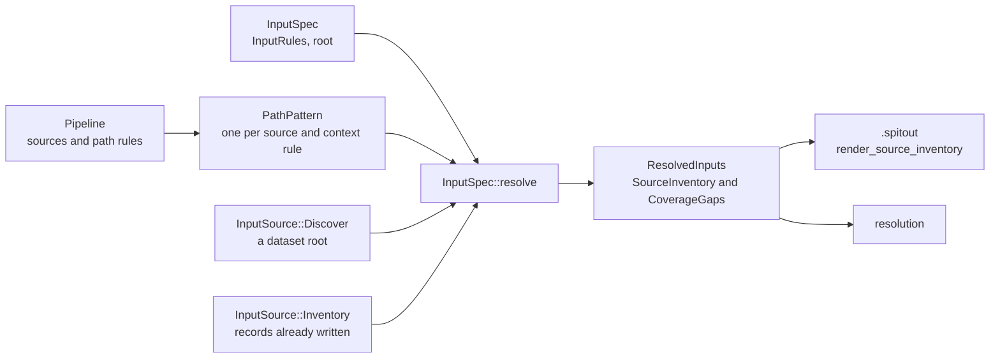

# Inputs

The input stage settles which contexts and source files a dataset holds. It reads a recipe's rules and the pipeline's source declarations. It either scans a dataset root, or takes records already written. It returns a plain `SourceInventory`, so resolution never sees a `discover`, `exclude`, `require` or `review` rule. `spit inputs` writes that inventory as a `.spitout`.

## Data

- **`InputSpec`** ([`src/inputs/mod.rs`](https://github.com/eclnz/spit/blob/dev/src/inputs/mod.rs)) is a parsed recipe: its pipeline, its root, its `InputRules`, its `ToolsFile`, and any records it writes itself.
- **`ToolsFile`** ([`src/inputs/tools.rs`](https://github.com/eclnz/spit/blob/dev/src/inputs/tools.rs)) is the `.spitenv` a `tools from` line names, as `read_tools_file` reads it: the file as written, the line, and a `Tool` for each of its lines, whose `ToolIdentity` is a declared text or a probe's arguments. The input stage only carries it: the command line hands its tools to the `BoundDag`, and nothing settles them against the dataset.
- **`InputRules`** ([`src/model/inputs.rs`](https://github.com/eclnz/spit/blob/dev/src/model/inputs.rs)) keeps the recipe's rules as written:
    - `context_paths`, unnamed `ContextPattern` directory patterns;
    - `exclusions`;
    - `reviews`, one `ReviewFile` for each `review product from file` line: the review, the file as written and its `path` under the recipe's folder, and the line;
    - `constraints`, which are the `require` rules and the conditional `exclude` rules (`CoverageAction::Drop`);
    - the source path rules, with the default in `source_default`.

    Nothing settles the rules in place. `InputRules::defaulted_sources` derives the sources the default covers, and `InputRules::source_paths_for` the rule the recipe gives each source.
- **`PathPattern`** ([`src/template/pattern.rs`](https://github.com/eclnz/spit/blob/dev/src/template/pattern.rs)) is a rule compiled once, by `PathPattern::new`, for each source's completed rule (`path_pattern` in [`src/inputs/pattern.rs`](https://github.com/eclnz/spit/blob/dev/src/inputs/pattern.rs)), each `contexts:` pattern, and each output's rule (`OutputPaths`). `PathPattern::match_path` gives a path's value of each dimension, still encoded; `PathPattern::reach` gives where a file parts from the rule. It is the pattern binding renders paths with, as [binding](binding.md) describes.
- **`InputSource`** says where the inventory comes from: `Discover(root)` scans a folder, and `Inventory(records)` takes records from a `.spitout` or the recipe.
- **`SourceInventory`** is a list of `SourceRecord`s: a product, a complete `EntityBinding`, and optionally the file's path. Beside them it keeps:
    - the deduplicated observed `contexts`;
    - the `source_paths` a recipe supplied;
    - what was `removed`, and why;
    - the `review_files`: a `ReviewRecord` for each review file, with its path, so a plan made from a `.spitout` names the file the runner reads;
    - the `root`.

    Context bindings carry dimensions and values, without rule names.
- **`ResolvedInputs`** is the stage's result:
    - the inventory;
    - each `CoverageGap`: a `require` rule that failed, with the sources it holds back;
    - the files skipped, the files that matched no rule, and each source whose rule matched no file (`MissedSource`, with the nearest file);
    - the incomplete companion groups;
    - the root that was scanned.

## Responsibilities

`InputSpec::resolve` runs these steps in order:

1. **Check the pipeline and the rules.** `validate_pipeline`, then `InputSpec::check`.
2. **Find the sources.**
    - Given a root, `discover` (in [`src/inputs/discover.rs`](https://github.com/eclnz/spit/blob/dev/src/inputs/discover.rs)) walks the folder. It matches files and folders against each source's completed path rule, and reads entity values from the placeholders. A `here` source is not looked for in the dataset: `append` (in [`src/inputs/local.rs`](https://github.com/eclnz/spit/blob/dev/src/inputs/local.rs)) adds its one record, with its path from the pipeline's folder, and a missing file is an error. Each unnamed `contexts:` pattern inside `inputs:` also matches directories and adds deduplicated bindings. Source matching and directory observations are independent; neither makes a source mandatory.
    - Given records, the stage takes them as they are, then applies the `exclude` rules (`Excluder`) and the conditional `exclude` rules (`apply_drops`).
3. **Settle each source's path rule.** `merge_source_paths` moves the recipe's rules into the inventory, and `inspect_paths` checks them with the pipeline's.
4. **Check the `require` rules.** `check_inventory` (in [`src/inputs/coverage.rs`](https://github.com/eclnz/spit/blob/dev/src/inputs/coverage.rs)) returns each `CoverageGap`. A rule counts a source family or an exact `contexts[dimensions]` domain within each observed group. Global `[]` grouping projects any observation to one empty binding; an empty inventory has no groups. So a missing image in one observed session fails, without a global subject or session count. A rule can also require entity values, such as `run=1,2`, in each group.
5. **Check each record's file.** `locate_sources` checks that each record's path fits its rule, including any shape on a placeholder. A source whose rules write no path keeps each record's path, which one of its rules must read back as the record.

While it scans, the stage also:

- **Applies `exclude` rules as it finds things** ([`src/inputs/exclusions.rs`](https://github.com/eclnz/spit/blob/dev/src/inputs/exclusions.rs)). Named exclusions remove matching observed contexts and files. Each conditional exclusion is judged against those retained observations, where an absent source has count zero. The groups any rule rejects are removed together, and requirements check what remains.
- **Does not scan the output root.** When the output root is inside the dataset root, `discover` leaves that folder and everything in it out of the listing, matched by its path with links resolved, so neither its files nor the folder itself meet a rule. The dataset root itself is scanned when outputs go there. Test: [`a_scan_leaves_out_an_output_root_inside_the_dataset`](https://github.com/eclnz/spit/blob/dev/tests/output_root.rs).
- **Leaves out SPIT's own files.** Files at an output's completed path, or inside an output folder, are not reported as unmatched sources, so an earlier run's outputs under the root are ignored (`OutputPaths` in [`src/inputs/pattern.rs`](https://github.com/eclnz/spit/blob/dev/src/inputs/pattern.rs)). An output whose path cannot be bound is skipped there, and resolution reports it. A file at the path of an output written beside a source (`OutputPaths::beside_source`) is left out before any rule is matched, so it is never read as a source either. Test: [`an_output_beside_a_source_is_neither_a_source_nor_an_unmatched_file`](https://github.com/eclnz/spit/blob/dev/tests/beside_inputs.rs).
- **Gives each identity one file.** Two files of one source that read as one identity, or one file that two rules of a source both match, are errors (`one_record_each` in [`src/inputs/duplicates.rs`](https://github.com/eclnz/spit/blob/dev/src/inputs/duplicates.rs), `source_record`). An `exclude path` rule removes the files and folders its path covers, and `prefer path` rules, after every exclusion, choose among the files of one identity. Tests: [`two_folders_of_one_identity_stop_until_one_is_excluded_by_path`](https://github.com/eclnz/spit/blob/dev/tests/messy_sources.rs), [`two_rules_of_one_source_may_not_match_one_file`](https://github.com/eclnz/spit/blob/dev/tests/messy_sources.rs), [`preferences_keep_one_path_of_each_identity_and_record_the_rest`](https://github.com/eclnz/spit/blob/dev/tests/found_paths.rs).
- **Never removes an identity's only file by `prefer path`.** A preference chooses only among two or more files of one identity. Test: [`a_preference_leaves_an_identity_read_once_alone`](https://github.com/eclnz/spit/blob/dev/tests/found_paths.rs).
- **Reports the near misses.** For each source whose rule matches no file, it records the unmatched file the rule matches furthest into, and where the two part.
- **Notes companion groups found only in part** (`incomplete_groups`), whether scanned or written as records. Records are grouped in one pass by `GroupKey`, and only an incomplete group's binding is written out as text.

**Tools files.** A `.spitenv` is read when the recipe is parsed at a path; one that is missing or malformed is an error on the `tools from` line, naming the file's own line. `InputSpec::check` fails when the pipeline declares a tool the file does not list (`InputError::MissingTool`).

**Review files.** The compiler never reads a review's file, or checks that it exists. Each `review ... from` line's file is recorded relative to the recipe's folder, and reaches the `.spitdag`, where the runner reads it on every run. `without_review_files` leaves the review files out of the dataset's files that no source rule matches.

**The root.**

- The root is the folder named by the pipeline's or the recipe's `root` line, relative to that file. `Pipeline::root` keeps it with its line, and imports don't copy it.
- `InputSpec::root_for` rejects two declarations, and lets a recipe take its pipeline's root.
- A pipeline run alone, with no `root` line, may take `--root`, relative to the working folder.
- `spit inputs -o` records the root in the `.spitout`, relative to it, and `dag` on a `.spitout` takes its root from there.

**Not done here:** matching sources to steps, which [resolution](resolution.md) does; and checking that a source's file exists on disk, which `dag` and `artifacts` do when they bind (see [binding](binding.md)).

## Invariants

- **Resolution sees only an inventory.** Nothing after this stage reads an `InputRules`, and the resolver may not use the `inputs` module. Test: [`step_modules_do_not_import_later_steps`](https://github.com/eclnz/spit/blob/dev/tests/architecture.rs).
- **A `.spitout` stands alone.** It carries every source identity, each source path rule the recipe supplied, and the path of each record whose rules write none, so `dag` and `artifacts` run from it without the recipe. Test: [`a_spitout_alone_drives_jobs_without_its_recipe`](https://github.com/eclnz/spit/blob/dev/tests/inputs.rs).
- **A recipe plans as its `.spitout` does.** `dag` and `artifacts` on a recipe check the inventory in memory rather than writing and reading it, through the same `Projection` ([`src/parser/render_inventory.rs`](https://github.com/eclnz/spit/blob/dev/src/parser/render_inventory.rs)) the writer uses: the source paths written, which records keep their path, and contexts sorted and deduplicated as the reader does. Tests: [`recipes_diagnosed_in_memory_match_their_text`](https://github.com/eclnz/spit/blob/dev/tests/outputs.rs), [`recipe_source_paths_and_reviews_diagnose_in_memory_as_in_text`](https://github.com/eclnz/spit/blob/dev/tests/outputs.rs).
- **A file fits one source.** A file that two sources' rules match is an error. Tests: [`a_file_matching_two_source_rules_is_rejected`](https://github.com/eclnz/spit/blob/dev/tests/discovery.rs), [`two_rules_that_both_read_a_file_still_conflict`](https://github.com/eclnz/spit/blob/dev/tests/placeholder_shapes.rs).
- **Exclusions are applied before expectations.** A context or file that an `exclude` rule removes is never reported missing. Tests: [`a_discovered_context_left_out_needs_no_files`](https://github.com/eclnz/spit/blob/dev/tests/exclusions.rs), [`an_expected_file_excluded_by_name_need_not_exist`](https://github.com/eclnz/spit/blob/dev/tests/exclusions.rs), [`an_excluded_file_may_lie_outside_the_discovered_contexts`](https://github.com/eclnz/spit/blob/dev/tests/exclusions.rs), [`a_session_missing_its_file_can_be_dropped_rather_than_fail_discovery`](https://github.com/eclnz/spit/blob/dev/tests/conditional_exclusions.rs).
- **A review file's contents never change the plan.** Tests: [`potential_dag_carries_review_scope_and_ignores_the_sheet_contents`](https://github.com/eclnz/spit/blob/dev/tests/reviews.rs), [`a_review_plans_every_job_whatever_its_verdicts`](https://github.com/eclnz/spit/blob/dev/tests/reviews.rs).
- **The `.spitout` carries each review file's reference, and nothing more.** A DAG made from a `.spitout` names the same files as one made from the recipe. Tests: [`the_spitout_records_only_where_each_review_file_is`](https://github.com/eclnz/spit/blob/dev/tests/reviews.rs), [`an_inventory_round_trip_preserves_the_review_file_reference`](https://github.com/eclnz/spit/blob/dev/tests/reviews.rs).
- **A value is one path component.** Encoding, matching and the `default entities:` separator check read one rule, `is_kept`, and no shape accepts a character an encoded value cannot hold. Test: [`every_shape_accepts_only_value_characters`](https://github.com/eclnz/spit/blob/dev/src/template/pattern.rs).
- **Shapes narrow matching only.** A placeholder's `Shape` decides which files match, and never changes how a value is written. Tests: [`a_leading_zero_is_kept`](https://github.com/eclnz/spit/blob/dev/tests/placeholder_shapes.rs), [`a_shape_on_an_output_or_a_default_is_an_error`](https://github.com/eclnz/spit/blob/dev/tests/placeholder_shapes.rs).

## Failure

- Every failure is an `InputError` ([`src/inputs/mod.rs`](https://github.com/eclnz/spit/blob/dev/src/inputs/mod.rs)):
    - a source with no path rule (`NoSourcePath`);
    - a recipe path rule that doesn't fit the pipeline, such as one for a product that is no source (`NotASource`), or for a source the pipeline gives a rule too (`PathInBoth`);
    - a root named in both files (`RootInBoth`);
    - an `exclude` rule that matched nothing (`UnmatchedExclusion`);
    - a conditional `exclude` rule that removed every group (`EveryGroupDropped`);
    - a path or resolve error.
- A failed `require` rule is not an error of the stage. It is a `CoverageGap`. `spit inputs` writes no `.spitout` while there is one, and `artifacts` reports each one.
- An incomplete companion group is a warning. A missing member matters only to a step that reads it, and resolution reports that step's missing input as it reports any other.
