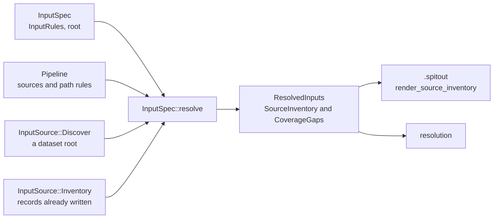

# Inputs

The input stage settles which contexts and source files a dataset holds. It reads a recipe's rules and the pipeline's source declarations. It either scans a dataset root, or takes records already written. It returns a plain `SourceInventory`, so resolution never sees a `discover`, `exclude` or `require` rule. `spit inputs` writes that inventory as a `.spitout`.

## Data

- **`InputSpec`** ([`src/inputs/mod.rs`](https://github.com/eclnz/spit/blob/dev/src/inputs/mod.rs)) is a parsed recipe: its pipeline, its root, its `InputRules`, and any records it writes itself.
- **`InputRules`** ([`src/model/inputs.rs`](https://github.com/eclnz/spit/blob/dev/src/model/inputs.rs)) keeps the recipe's rules as written:
    - `discoveries`, the `discover ... from dirs` rules;
    - `exclusions`;
    - `constraints`, which are the `require` rules and the conditional `exclude` rules (`CoverageAction::Drop`);
    - the source path rules, with the default in `source_default`.

    Nothing settles the rules in place. `InputRules::defaulted_sources` derives the sources the default covers, and `InputRules::source_paths_for` the rule the recipe gives each source.
- **`InputSource`** says where the inventory comes from: `Discover(root)` scans a folder, and `Inventory(records)` takes records from a `.spitout` or the recipe.
- **`SourceInventory`** is a list of `SourceRecord`s: a product, a complete `EntityBinding`, and optionally the file's path. Beside them it keeps:
    - the observed `contexts`, and in `discovered` the contexts each named `discover` rule found;
    - the `source_paths` a recipe supplied;
    - what was `removed`, and why;
    - the `root`.

    A dataset indexer may build one directly. Its text form, the `.spitout`, is read by `parse_source_inventory` and written by `render_source_inventory`.
- **`ResolvedInputs`** is the stage's result:
    - the inventory;
    - each `CoverageGap`: a `require` rule that failed, with the sources it holds back;
    - the files skipped, the files that matched no rule, and each source whose rule matched no file (`MissedSource`, with the nearest file);
    - the incomplete companion groups;
    - the root that was scanned.

## Responsibilities

`InputSpec::resolve` runs these steps in order:

1. **Check the pipeline and the rules.** `validate_pipeline`, then `InputSpec::check`.
2. **Find the sources.**
    - Given a root, `discover` (in [`src/inputs/discover.rs`](https://github.com/eclnz/spit/blob/dev/src/inputs/discover.rs)) walks the folder. It matches files and folders against each source's completed path rule, and reads entity values from the placeholders. A `discover name: [dimensions] from dirs pattern` rule also matches directories, and adds their bindings as contexts. A source product whose dimensions such a rule covers is then expected in every one of its contexts.
    - Given records, the stage takes them as they are, then applies the `exclude` rules (`Excluder`) and the conditional `exclude` rules (`apply_drops`).
3. **Settle each source's path rule.** `merge_source_paths` moves the recipe's rules into the inventory, and `inspect_paths` checks them with the pipeline's.
4. **Check the `require` rules.** `check_inventory` (in [`src/inputs/coverage.rs`](https://github.com/eclnz/spit/blob/dev/src/inputs/coverage.rs)) returns each `CoverageGap`. A rule counts a source family within each observed context. It does not set how many contexts a dataset has. So a missing image in one observed session fails, without a global subject or session count. A rule can also require entity values, such as `run=1,2`, in each group.
5. **Check each record's file.** `locate_sources` checks that each record's path fits its rule, including any shape on a placeholder.

While it scans, the stage also:

- **Applies `exclude` rules as it finds things** ([`src/inputs/exclusions.rs`](https://github.com/eclnz/spit/blob/dev/src/inputs/exclusions.rs)). An excluded context expects no files, and an excluded file may lie outside the discovered contexts. Each conditional `exclude` rule is then judged once against what was found, counting a file a context expects but lacks as absent. The groups any rule rejects are removed together, before expected files are checked.
- **Leaves out SPIT's own files.** Files at an output's completed path, or inside an output folder, are not reported as unmatched sources, so an earlier run's outputs under the root are ignored (`OutputPaths` in [`src/inputs/pattern.rs`](https://github.com/eclnz/spit/blob/dev/src/inputs/pattern.rs)). An output whose path cannot be bound is skipped there, and resolution reports it.
- **Reports the near misses.** For each source whose rule matches no file, it records the unmatched file the rule matches furthest into, and where the two part.
- **Notes companion groups found only in part** (`incomplete_groups`), whether scanned or written as records. Records are grouped in one pass by `GroupKey`, and only an incomplete group's binding is written out as text.

**The root.**

- The root is the folder named by the pipeline's or the recipe's `root` line, relative to that file. `Pipeline::root` keeps it with its line, and imports don't copy it.
- `InputSpec::root_for` rejects two declarations, and lets a recipe take its pipeline's root.
- A pipeline run alone, with no `root` line, may take `--root`, relative to the working folder.
- `spit inputs -o` records the root in the `.spitout`, relative to it, and `dag` on a `.spitout` takes its root from there.

**Not done here:** matching sources to steps, which [resolution](resolution.md) does; and checking that a source's file exists on disk, which `dag` and `artifacts` do when they bind (see [binding](binding.md)).

## Invariants

- **Resolution sees only an inventory.** Nothing after this stage reads an `InputRules`.
- **A `.spitout` stands alone.** It carries every source identity, and each source path rule the recipe supplied, so `dag` and `artifacts` run from it without the recipe. Named contexts whose rule is gone are kept as a record of where they came from.
- **A file fits one source.** A file two sources' rules match is an error.
- **Exclusions are applied before expectations.** A context or file that an `exclude` rule removes is never reported missing.
- **Shapes narrow matching only.** A placeholder's `Shape` decides which files match, and never changes how a value is written.

The tests are `tests/discovery.rs`, `tests/exclusions.rs`, `tests/conditional_exclusions.rs`, `tests/coverage.rs`, `tests/sidecars.rs`, `tests/missed_sources.rs`, `tests/dataset_root.rs` and `tests/inline_inputs.rs`.

## Failure

- Every failure is an `InputError` ([`src/inputs/mod.rs`](https://github.com/eclnz/spit/blob/dev/src/inputs/mod.rs)):
    - a source with no path rule (`NoSourcePath`);
    - a recipe path rule that doesn't fit the pipeline, such as one for a product that is no source (`NotASource`), or for a source the pipeline gives a rule too (`PathInBoth`);
    - a root named in both files (`RootInBoth`);
    - an `exclude` rule that matched nothing (`UnmatchedExclusion`);
    - a conditional `exclude` rule that removed every group (`EveryGroupDropped`);
    - a path or resolve error.
- A failed `require` rule is not an error of the stage. It is a `CoverageGap`. `spit inputs` writes no `.spitout` while there is one, and `artifacts` reports each one.
- An incomplete companion group is a warning. A missing member matters only to a step that reads it, and resolution reports that step's missing input as it reports any other.
