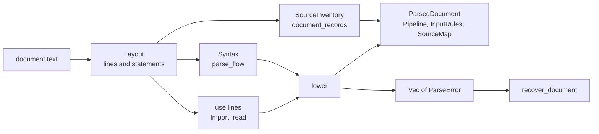

# Parsing and lowering

Parsing and lowering turn the text of a `.spit` pipeline or a `.spitin` recipe into a `Pipeline`, together with every error the text has. A recipe also gives its `InputRules` and any records it writes. What this part decides is the document's structure and its declarations. Everything that needs the whole pipeline or a dataset runs later, on the `Pipeline` it returns.

## Data

Each step, the function that does it, and what it gives:

1. **Lay out.** `Layout::new` ([`parser/layout.rs`](https://github.com/eclnz/spit/blob/dev/src/parser/layout.rs)) gives a `Layout`: each `Line`, and each `Statement`.
2. **Parse.** `parse_flow` ([`parser/flow.rs`](https://github.com/eclnz/spit/blob/dev/src/parser/flow.rs)) gives `Syntax`: the statements that parsed, and a `ParseError` for each that did not.
3. **Import.** `Import::read` ([`imports.rs`](https://github.com/eclnz/spit/blob/dev/src/imports.rs)) gives the `Pipeline` each `use` line brings in.
4. **Lower.** `lower` ([`lower/mod.rs`](https://github.com/eclnz/spit/blob/dev/src/lower/mod.rs), [`lower/expand.rs`](https://github.com/eclnz/spit/blob/dev/src/lower/expand.rs)) gives a `PipelineBuilder`, holding the `Pipeline`, `InputRules` and `SourceMap`, and the errors.
5. **Read records.** `document_records` ([`parser/inventory.rs`](https://github.com/eclnz/spit/blob/dev/src/parser/inventory.rs)) gives the `SourceInventory` a recipe writes.
6. **Assemble.** `parse_layout` ([`lower/mod.rs`](https://github.com/eclnz/spit/blob/dev/src/lower/mod.rs)) gives a `ParsedDocument`, and every error.
7. **Recover.** `recover_document` ([`diagnostics/recovery.rs`](https://github.com/eclnz/spit/blob/dev/src/diagnostics/recovery.rs)) gives the errors, less those that only repeat another.

The entry points differ in what they read and what they return:

- `parse_pipeline` reads a pipeline with no imports. `parse_pipeline_at` reads one at a path, and resolves its `use` lines relative to that path (`parse_located_document_recovering`).
- `parse_input_spec` and `parse_input_spec_at` read a recipe. They first take out its `pipeline` and `root` lines (`header_lines` in `src/inputs/mod.rs`), blanking them so that the other lines keep their numbers.
- The `Result` entry points return the first error. The `_recovering` functions return the document with every error, which `src/diagnostics` and the editor read.
- `Kind` says which file is being read. In a `Kind::Pipeline`, a `discover`, `require` or `exclude` rule is an error, and so are records.

## Responsibilities

- **`Layout` decides structure, and nothing else.** It reads each line's indentation and its first word, and from those alone it works out:
    - what each line starts with (`Head`): blank, a statement's `Keyword`, a records `Header`, a step, or something else;
    - which lines make each statement. A statement goes on while its parentheses are open. A `command`, `verify` or `check` statement also takes the lines indented beneath it.
    - which statements open a block, and which block holds each statement. The blocks are a `stage`, an operation body, `default:`, and a keyword alone with its colon, such as `source:`.
    - which lines are records: from a `sources:` or `contexts:` header to the next statement or step.

    The parser, imports, recipe checks, the inventory reader, the editor's words (`builtin_words`) and recovery all read lines from a `Layout`, so they agree on what each line is.

- **`parse_flow` parses each statement's content,** in the block that `Layout` gave it. A statement that fails gives a `ParseError` and is left out.
- **`lower` builds the `Pipeline`.** It:
    - checks that each name is declared once, and before it is used;
    - expands each call to an operation carried out by steps into those steps (`add_flow_step`), records the call in `Pipeline::calls`, and checks each body where it is declared (`check_body`);
    - infers the dimensions of the products a step makes;
    - puts every product's dimensions in the pipeline's order (`order_dimensions` in `src/order.rs`);
    - runs the checks that need the whole document, on what it lowered: `check_bodies_have_no_commands`, `check_source_beside_paths`, and the `{@entities}` spellings.
- **Imports.** Each `use` line is read from the same `Layout` as the statements. Its library is parsed in turn, and the definitions it selects are merged into the caller.
- **Not done here:**
    - checking each step against its operation, types and cycles, which `compile` does (`validate_pipeline`);
    - checking path rules, which `paths` does;
    - anything that needs a dataset.

## Invariants

- **Every line is in exactly one statement.** Test: `each_line_is_read_once_with_its_head` in `src/parser/layout.rs`.
- **One parse reads one `Layout`.** A document's `use` lines, statements and records all come from the same layout (`parse_document_at_inner`, `parse_layout`). Three readers lay the text out again for their own pass: `header_lines` and `check_input_lines` for a recipe, and `recover_document`.
- **Structure comes before content.** A statement that fails to parse never changes how the lines after it are read:
    - a failed line still closes the blocks it is outdented from;
    - a block whose header fails keeps its lines, which are read as statements of the block around it;
    - a stage's first line sets the indentation of its lines, even when that line fails.

    Tests: `a_line_that_fails_still_closes_the_stage_it_is_outdented_from`, `a_stage_header_that_fails_keeps_its_lines`, `the_first_line_of_a_stage_sets_its_indentation_even_when_it_fails` and `the_steps_of_a_body_whose_header_fails_are_read_as_ordinary_statements`, in `tests/syntax_errors.rs`; `blocks_come_from_indentation_and_the_opening_line` in `src/parser/layout.rs`.

- **A stray line moves nothing.** A line with no keyword and no `=` can start no statement. It fails where it stands, and neither opens nor closes a block (`Statement::stray`).
- **There is one rule for a step,** `is_step`, which every reader takes from `Head::Step`. Test: `a_step_is_names_then_a_call`.
- **Records are blank to statements.** Lines a `sources:` or `contexts:` header starts are read only by the inventory reader. Test: `records_are_marked_and_blank_to_statements`.
- **A statement is lowered whole or not at all.** Every failure comes before the builder changes, except a call whose expansion fails part way, which `add_flow_step` rolls back with `PipelineBuilder::journal`. So the statements after a failed one lower as they would without it. Tests: `each_bad_step_of_a_body_is_an_error_and_the_operation_keeps_the_rest` and `a_body_with_every_step_failing_is_reported_by_its_steps_alone`, in `tests/syntax_errors.rs`.
- **Expansion uses a worklist, not recursion,** so bodies nest to any depth and a chain of steps can be any length. Test: `a_long_chain_of_steps_compiles_without_overflowing_the_stack` in `tests/scale.rs`, which is run on request.
- **The first error is the same either way.** The `Result` entry points return the first error that the `_recovering` ones give.
- **Damaged text never panics.** Test: `tests/mutation_fuzz.rs`.
- **The cost of errors grows with the errors, not the file.** Test: the `..._in_reasonable_time` cases in `tests/scale.rs`.

## Failure

- A statement that fails is left out whole, and its `ParseError` is placed at its line (`ParseError::within`). Lowering goes on with the next statement.
- `lower` returns the syntax errors and the lowering errors in the order of their statements, then the errors of the whole-document checks.
- A `use` line that fails imports nothing.
- Records in a pipeline are one error, `ParseErrorKind::MisplacedRecords`, however many lines they span. Test: `records_in_a_pipeline_are_one_error_however_many_lines`.
- `recover_document` sorts the errors by line, and leaves out an error that only repeats another:
    - a call to an operation whose declaration or `use` line failed;
    - a body left with no steps because each of its steps failed.

    Test: `calls_to_an_operation_that_failed_to_declare_repeat_its_error`.

How the errors that remain are ordered, placed and shown is described under [diagnostics](phases.md).

## Trade-offs

- **Structure from the surface alone.** Because a line's content never decides structure, one bad line cannot move the lines after it. The cost is that `Layout` must classify a line from its first word, which is why statement keywords are reserved: no product may take one's name.
- **Recovery reads the text again.** `recover_document` lays the text out a second time, and reads a failed line's text to find the operation it declares. This keeps the parser free of recovery state. #133 tracks reading the declaration from the parse instead.
