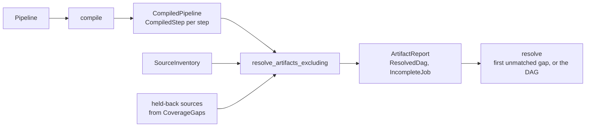

# Resolution

Resolution turns a `Pipeline` and a `SourceInventory` into jobs. `compile` first checks everything the pipeline's text decides, with no data. The resolver then expands each checked step into one job per context its driving input gives, over the inventory's artifacts. The result is a `ResolvedDag` of logical artifacts and jobs, with no paths and no commands; [binding](binding.md) adds those.

## Data

- **`CompiledPipeline`** ([`src/compile/mod.rs`](https://github.com/eclnz/spit/blob/dev/src/compile/mod.rs)) holds each step that checked, producers before consumers. Each `CompiledStep` holds:
    - its `Invocation` and `OperationDef`;
    - each output's product, with the type inferred for it;
    - its `Substitutions`;
    - its `StepShape`: the driving input, and the dimensions each other input is matched on ([`src/compile/steps.rs`](https://github.com/eclnz/spit/blob/dev/src/compile/steps.rs)).
- **`ResolvedDag`** ([`src/model/dag.rs`](https://github.com/eclnz/spit/blob/dev/src/model/dag.rs)) holds:
    - the jobs, each naming its step by `StepId`, with an ID local to this resolution, which changes when the inventory does;
    - the steps (`DagStep`), with each step's operation and stage once;
    - the `Artifacts` table every job refers to by `ArtifactId`;
    - the file of each source whose record gave one.
- **`ArtifactReport`** holds every source, the DAG of the jobs that can run, each `IncompleteJob` with its gaps, and each `CoverageGap`. A `Gap` is one of two kinds:
    - `Unmatched`: a missing or ambiguous input, or a collection below its minimum;
    - `Blocked`: an input that is itself incomplete, or a source a coverage gap holds back.

The entry points are in [`src/resolver/mod.rs`](https://github.com/eclnz/spit/blob/dev/src/resolver/mod.rs):

- `resolve(&pipeline, &inventory)` gives the `ResolvedDag`, or fails at the first job that cannot be made.
- `resolve_artifacts_excluding` keeps going, and gives the whole `ArtifactReport`. `spit artifacts` renders it, and succeeds even when some artifacts are incomplete.
- `resolve_artifacts_partial` is the same, except that an aggregate's `many` input may use only its complete members. `dag --partial` uses it.

## Responsibilities

**Matching** ([`src/resolver/matching.rs`](https://github.com/eclnz/spit/blob/dev/src/resolver/matching.rs)):

- **Each step has a driving input, which gives it one job per context.**
    - In a preserve step, the driver is the single-artifact input with the most dimensions, provided every other input is matched on a subset of them. Port order never changes the choice. The outputs take the driver's dimensions.
    - In an aggregate step, the driver is its one `many` input, grouped by every dimension except those its `vary` names.
- **Every other input is matched to each job's context, and must leave exactly one artifact.**
- **Selectors narrow a binding.**
    - `where(dim=value)` keeps the matching artifacts, and takes the pinned dimension out of matching.
    - `same(dim, ...)` matches on the listed dimensions alone.
    - `each(dim, ...)` broadcasts a single input over dimensions the driver lacks. The step runs for every combination of the driver's groups with the values that input has, and the outputs gain those dimensions. An input that broadcasts cannot drive.
- **Only a step's driving artifacts create contexts.** A step whose driver has no artifact in a context has no job there, complete or not.

**Order.** Artifact families, jobs and collections follow the pipeline's dimension order, which lowering sets ([`src/order.rs`](https://github.com/eclnz/spit/blob/dev/src/order.rs)). Runs of digits compare as numbers, so `wave2` comes before `wave10`.

**Types** ([`src/compile/types.rs`](https://github.com/eclnz/spit/blob/dev/src/compile/types.rs)). Type checking is separate from matching, and optional.

- An omitted type is `TypeExpr::Unknown`. Names, dimensions and cardinality drive resolution even when every type is unknown.
- `infer_types` checks each step once, in dependency order, so a known contradiction fails with no inventory at all.
    - Each step unifies its ports with its products under fresh variables.
    - Each output takes its port's type with the variables substituted, and unresolved variables erased to `Unknown`, so no variable leaks into another step.
    - Every job of the step takes those types.
- `Unknown` leaves compatibility undecided. It is never a conflict.
- `check_calls` holds each call of an operation carried out by steps to the operation's own signature, under one set of variables per call.
- The type engine has structural unification and type variables, with no subtypes: bare `MRI` is not a supertype of `MRI<T1w,Anatomical>`. #138 tracks declared type parameters.

**Not done here:**

- settling the dataset, which the [input stage](inputs.md) does before resolution;
- paths and commands, which [binding](binding.md) adds.

## Invariants

- **Jobs come in dependency order, numbered from 1.** Every input's producer is expanded before its consumer is matched, and a job's ID is its place in that order. Test: [`tracks_dependencies_through_full_pipeline`](https://github.com/eclnz/spit/blob/dev/tests/resolver.rs).
- **An incomplete job's outputs stay candidates for later steps.** A consumer of one is reported as blocked, not left out without a word. Test: [`keeps_complete_jobs_and_blocks_consumers_of_incomplete_ones`](https://github.com/eclnz/spit/blob/dev/tests/artifacts.rs).
- **A blocked gap always follows the gap that blocks it.** So the first unmatched gap explains every failure, and `resolve` returns it (`first_failure`). Test: [`resolve_fails_with_the_first_gap_the_report_finds`](https://github.com/eclnz/spit/blob/dev/tests/artifacts.rs).
- **A coverage gap holds back its sources.** A job that needs one is blocked, as it would be by an incomplete producer. Test: [`a_coverage_gap_holds_back_its_sources_and_blocks_their_consumers`](https://github.com/eclnz/spit/blob/dev/tests/artifacts.rs).
- **Types are checked before any job is made.** Test: [`checks_types_before_concrete_expansion`](https://github.com/eclnz/spit/blob/dev/tests/resolver.rs).

## Failure

- A pipeline error, such as an unknown operation, a type conflict or a cycle, fails `compile` before any job is made. Each is a `ResolveError` ([`src/error.rs`](https://github.com/eclnz/spit/blob/dev/src/error.rs)).
- An input the inventory cannot supply makes a job incomplete. `resolve` fails with the first such gap, and the report keeps them all.
