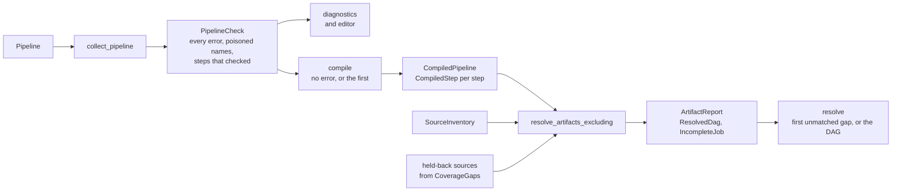

# Resolution

Resolution turns a `Pipeline` and a `SourceInventory` into jobs. `collect_pipeline` first checks everything the pipeline's text decides, with no data, and reports every error it finds. Only a pipeline with none compiles. The resolver then expands each checked step into one job per context its driving input gives, over the inventory's artifacts. The result is a `ResolvedDag` of logical artifacts and jobs, with no paths and no commands; [binding](binding.md) adds those.

## Data

- **`PipelineCheck`** ([`src/compile/mod.rs`](https://github.com/eclnz/spit/blob/dev/src/compile/mod.rs)) is the one check of a pipeline's text. `collect_pipeline` makes it, and it holds:
    - every error, each with the declaration or step it belongs to (`DefinitionSubject`);
    - the poisoned names: products and operations that failed, or that are made by a step that failed or reads from one;
    - the steps that checked. With errors, they are part of a pipeline, which the editor describes but nothing resolves.
- **`CompiledPipeline`** holds each step of a pipeline with no error, producers before consumers. Only `compile` makes one, from a `PipelineCheck` with no errors; otherwise it returns the first error. `validate_pipeline` is `compile` without the result. Each `CompiledStep` holds:
    - its `Invocation` and `OperationDef`;
    - each output's product, with the type inferred for it;
    - its `Substitutions`;
    - its `StepShape`: the driving input, and the dimensions each other input is matched on ([`src/compile/steps.rs`](https://github.com/eclnz/spit/blob/dev/src/compile/steps.rs)).
- **`ResolvedDag`** ([`src/model/dag.rs`](https://github.com/eclnz/spit/blob/dev/src/model/dag.rs)) holds:
    - the jobs, each naming its step by `StepId`, with an ID local to this resolution, which changes when the inventory does;
    - the steps (`DagStep`), with each step's operation and stage once;
    - the `Artifacts` table every job refers to by `ArtifactId`;
    - the file of each source whose record gave one.
- **`ArtifactReport`** holds every source, the DAG of the jobs that can run, each `IncompleteJob` with its gaps, and each `CoverageGap`. A `Gap` is one of two kinds:
    - `Unmatched`: a missing or ambiguous input, or a collection below its minimum;
    - `Blocked`: an input that is itself incomplete, or a source a coverage gap holds back.

The entry points are in [`src/resolver/mod.rs`](https://github.com/eclnz/spit/blob/dev/src/resolver/mod.rs):

- `resolve(&pipeline, &inventory)` gives the `ResolvedDag`, or fails at the first job that cannot be made.
- `resolve_artifacts_excluding` keeps going, and gives the whole `ArtifactReport`. `spit artifacts` renders it, and succeeds even when some artifacts are incomplete.
- `resolve_artifacts_partial` is the same, except that an aggregate's `many` input may use only its complete members. `dag --partial` uses it.

## Responsibilities

**Matching** ([`src/resolver/matching.rs`](https://github.com/eclnz/spit/blob/dev/src/resolver/matching.rs)):

- **Each step has a driving input, which gives it one job per context.**
    - In a preserve step, the driver is the single-artifact input with the most dimensions, provided every other input is matched on a subset of them. Port order never changes the choice. The outputs take the driver's dimensions.
    - In an aggregate step, the driver is its one `many` input, grouped by every dimension except those its `vary` names.
- **Every other input is matched to each job's context, and must leave exactly one artifact.**
- **Selectors narrow a binding.**
    - `where(dim=value)` keeps the matching artifacts, and takes the pinned dimension out of matching.
    - `same(dim, ...)` matches on the listed dimensions alone.
    - `each(dim, ...)` broadcasts a single input over dimensions the driver lacks. The step runs for every combination of the driver's groups with the values that input has, and the outputs gain those dimensions. An input that broadcasts cannot drive.
- **Only a step's driving artifacts create contexts.** A step whose driver has no artifact in a context has no job there, complete or not.

**Step order** (`invocation_order`, in [`src/compile/definitions.rs`](https://github.com/eclnz/spit/blob/dev/src/compile/definitions.rs)). Steps are checked and expanded in dependency order, whatever order they are written in. The order is Tarjan's strongly connected components, walking from each step to the producers of its inputs with an explicit stack. A component of more than one step, or a step that reads itself, has no order. It is one `Cycle`, shown as a loop through it from the step the walk reached first, and its steps' outputs are poisoned.

**Artifact order.** Artifact families, jobs and collections follow the pipeline's dimension order, which lowering sets ([`src/order.rs`](https://github.com/eclnz/spit/blob/dev/src/order.rs)). Runs of digits compare as numbers, so `wave2` comes before `wave10`.

**Types** ([`src/compile/types.rs`](https://github.com/eclnz/spit/blob/dev/src/compile/types.rs)). Type checking is separate from matching, and optional.

- An omitted type is `TypeExpr::Unknown`. Names, dimensions and cardinality drive resolution even when every type is unknown.
- `infer_types` checks each step once, in dependency order, so a known contradiction fails with no inventory at all.
    - Each step unifies its ports with its products under fresh variables.
    - Each output takes its port's type with the variables substituted, and unresolved variables erased to `Unknown`, so no variable leaks into another step.
    - Every job of the step takes those types.
- `Unknown` leaves compatibility undecided. It is never a conflict.
- `check_calls` holds each call of an operation carried out by steps to the operation's own signature, under one set of variables per call.
- Under `types strict` (`TypeChecking::Strict`), `check_strict` ([`src/compile/strict.rs`](https://github.com/eclnz/spit/blob/dev/src/compile/strict.rs)) runs once inference is done. It reports each source, each port of an operation a step or call uses, and each output of a checked step whose type has an `Unknown` part. Inference erases a variable no input fixes to `Unknown`, so an open variable is reported at the product, where a written type fixes it. A step that reads a product or runs an operation already reported is not reported again. `Pipeline::types` comes from the file given to SPIT, never from an import.
- The type engine has structural unification and type variables, with no subtypes: bare `MRI` is not a supertype of `MRI<T1w,Anatomical>`. #138 tracks declared type parameters.

**Not done here:**

- settling the dataset, which the [input stage](inputs.md) does before resolution;
- paths and commands, which [binding](binding.md) adds.

## Invariants

- **Jobs come in dependency order, numbered from 1.** Every input's producer is expanded before its consumer is matched, and a job's ID is its place in that order. Test: [`tracks_dependencies_through_full_pipeline`](https://github.com/eclnz/spit/blob/dev/tests/resolver.rs).
- **An incomplete job's outputs stay candidates for later steps.** A consumer of one is reported as blocked, not left out without a word. Test: [`keeps_complete_jobs_and_blocks_consumers_of_incomplete_ones`](https://github.com/eclnz/spit/blob/dev/tests/artifacts.rs).
- **A blocked gap always follows the gap that blocks it.** So the first unmatched gap explains every failure, and `resolve` returns it (`first_failure`). Test: [`resolve_fails_with_the_first_gap_the_report_finds`](https://github.com/eclnz/spit/blob/dev/tests/artifacts.rs).
- **A coverage gap holds back its sources.** A job that needs one is blocked, as it would be by an incomplete producer. Test: [`a_coverage_gap_holds_back_its_sources_and_blocks_their_consumers`](https://github.com/eclnz/spit/blob/dev/tests/artifacts.rs).
- **Types are checked before any job is made.** Test: [`checks_types_before_concrete_expansion`](https://github.com/eclnz/spit/blob/dev/tests/resolver.rs).
- **Each group of steps in a loop is one error, and a pipeline with one never resolves.** The steps that read from a loop are not checked, and the rest of the pipeline still is, in dependency order. Tests: [`every_independent_cycle_is_reported_once_and_quiets_what_reads_it`](https://github.com/eclnz/spit/blob/dev/tests/diagnostics.rs), [`a_cycle_is_reported_once_at_the_step_it_was_found_at`](https://github.com/eclnz/spit/blob/dev/tests/diagnostics.rs).
- **Under `types strict`, a pipeline whose types inference completes passes, and a missing type is reported once, where it is missing.** Tests: [`a_type_declared_once_and_inferred_through_generic_steps_passes`](https://github.com/eclnz/spit/blob/dev/tests/strict_types.rs), [`an_untyped_source_is_reported_at_its_declaration_and_quiets_what_reads_it`](https://github.com/eclnz/spit/blob/dev/tests/strict_types.rs).
- **A failure is reported once, not again by what reads it.** A step that uses a poisoned name is skipped, and poisons its own outputs. Tests: [`uses_of_a_failed_declaration_or_step_are_not_reported_again`](https://github.com/eclnz/spit/blob/dev/tests/diagnostics.rs), [`a_product_two_steps_make_quiets_every_step_that_reads_it`](https://github.com/eclnz/spit/blob/dev/tests/diagnostics.rs), [`every_independent_cycle_is_reported_once_and_quiets_what_reads_it`](https://github.com/eclnz/spit/blob/dev/tests/diagnostics.rs).

## Failure

- A pipeline error, such as an unknown operation, a type conflict or a cycle, fails `compile` before any job is made. Each is a `ResolveError` ([`src/error.rs`](https://github.com/eclnz/spit/blob/dev/src/error.rs)).
- `collect_pipeline` reports every error that does not follow from another:
    - each declaration's check gives its first fault;
    - a step's shape is checked only once its types hold, since a product of the wrong type at a port is most often an argument in the wrong place, which would make the shape wrong too;
    - a product two steps make is reported as a duplicate declaration, not also as having more than one producing invocation;
    - a product whose path rule names a dimension no product has is not also checked for the dimensions its rule omits, since the unknown name is most often a misspelling of one it has;
- The command line diagnoses a file before `inputs`, `dag` or `artifacts` uses it, so each of those prints every error, not only the first ([diagnostics](diagnostics.md)).
- An input the inventory cannot supply makes a job incomplete. `resolve` fails with the first such gap, and the report keeps them all.
