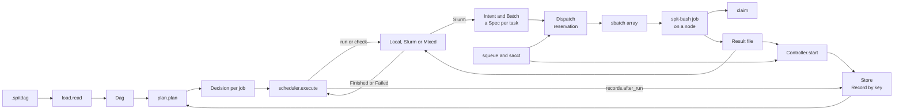

# The runner

spit-bash reads a `.spitdag` and nothing else of SPIT's. It plans each job against its state, runs what must run through an executor, and records what succeeded. With the Slurm executor, work outlives the process that submitted it, so the runner keeps three kinds of evidence apart: a **reservation** of scheduler capacity, a **result** a task writes, and a **record** in the state. This page covers which part owns each, and the order in which a run, or a run after a restart, may use them. How to run spit-bash is in [its README](https://github.com/eclnz/spit/blob/dev/runner/README.md); the DAG's fields are in [the DAG format](../spitdag.md).

## Data

- **`Dag`** ([`model.py`](https://github.com/eclnz/spit/blob/dev/runner/src/spit_bash/model.py)), made by `load.read` ([`load.py`](https://github.com/eclnz/spit/blob/dev/runner/src/spit_bash/load.py)), holds the jobs verdicts admit, with each job's `Work`: its state key, which names what it makes by products and entities, and its fingerprint. A job a review or screen holds back or rejects is a `GatedJob`, which keeps its key, so it still owns its record.
- **`Record`** ([`state/record.py`](https://github.com/eclnz/spit/blob/dev/runner/src/spit_bash/state/record.py)) is what one success left: fingerprint, file stamps and hashes, the run that made the outputs, and for a Slurm job the attempt, memory and time limit it succeeded with. `records.after_run` ([`reuse/records.py`](https://github.com/eclnz/spit/blob/dev/runner/src/spit_bash/reuse/records.py)) makes it. `Store` ([`state/store.py`](https://github.com/eclnz/spit/blob/dev/runner/src/spit_bash/state/store.py)) keeps records by key in `state.jsonl`.
- **`Decision`** ([`plan.py`](https://github.com/eclnz/spit/blob/dev/runner/src/spit_bash/plan.py)) is one job's status and cause, from its record and its files' stamps.
- **`Executor`** ([`execute/executor.py`](https://github.com/eclnz/spit/blob/dev/runner/src/spit_bash/execute/executor.py)) runs or checks a job it is given and says how it ended. `Local` runs it here; `Slurm` ([`slurm/executor.py`](https://github.com/eclnz/spit/blob/dev/runner/src/spit_bash/slurm/executor.py)) holds a `Want` per job it waits on; `Mixed` sends each job to one of the two.
- **`Intent`** ([`slurm/intent.py`](https://github.com/eclnz/spit/blob/dev/runner/src/spit_bash/slurm/intent.py)) is one array as the controller means to submit it, named by a hash of its manifest: the `Identity` of each task by index. It is written, with its `Batch` ([`slurm/batch.py`](https://github.com/eclnz/spit/blob/dev/runner/src/spit_bash/slurm/batch.py)), before `sbatch`. Each task's `Spec` carries its job, its mode, and the attempt and resources it was submitted with.
- **`Dispatch`** ([`slurm/dispatch.py`](https://github.com/eclnz/spit/blob/dev/runner/src/spit_bash/slurm/dispatch.py)) is the reservation: an intent's array, once Slurm has accepted it, and the indices with no terminal evidence yet. `Dispatches.reserve` writes it before `sbatch`, `accept` binds it to the array, and `reconcile` releases indices only on terminal states from `squeue` or `sacct`.
- **A claim** ([`slurm/claim.py`](https://github.com/eclnz/spit/blob/dev/runner/src/spit_bash/slurm/claim.py)) is the file a task creates exclusively before it touches an output, one per intent and index.
- **`Result`** ([`slurm/result.py`](https://github.com/eclnz/spit/blob/dev/runner/src/spit_bash/slurm/result.py)) is the only thing a task tells the controller: its job's key and fingerprint, how it ended, the files it made with their hashes, and the attempt and resources from its `Spec`. `node.perform` ([`slurm/node.py`](https://github.com/eclnz/spit/blob/dev/runner/src/spit_bash/slurm/node.py)) writes it atomically.
- **`Controller`** ([`slurm/controller.py`](https://github.com/eclnz/spit/blob/dev/runner/src/spit_bash/slurm/controller.py)) holds the folder's lease, and its `start` reads the queue, the reservations and the results left unread before planning.

## Responsibilities

- **The scheduler alone writes the state.** An executor returns `Finished` or `Failed`; [`execute/scheduler.py`](https://github.com/eclnz/spit/blob/dev/runner/src/spit_bash/execute/scheduler.py) turns a success into a record. On a node, a task only writes its result.
- **Each kind of evidence has one producer and one use.**
  - A reservation is made by the controller, before submission, and decides free capacity. Only Slurm's terminal states release it.
  - A result is made by the task, and decides what its job did. It never frees capacity.
  - A record is made by the scheduler, from a result or a local run, and decides reuse in later runs.
- **Restart uses them in this order.** A run takes the folder's lease with `Controller.lease`, then `Controller.start` reads the queue, binds and releases reservations from it and then from `sacct`, and refuses to write while an acceptance is unresolved. Then it records each key's newest success whose task has ended and whose fingerprint the DAG still has, as the watching controller would have, and only then deletes the results. Planning comes after, on the updated state.
- **`plan` reads and acts on nothing.** With `write` off, `start` applies the same records in memory, through `Store.assume`, and keeps every file.
- **`reconcile`** ([`slurm/reconcile.py`](https://github.com/eclnz/spit/blob/dev/runner/src/spit_bash/slurm/reconcile.py)) is a pure function from what the run wants and what the queue shows to what to wait on, cancel and submit.

## Invariants

- No second controller works in one folder at a time: [`test_a_second_controller_of_the_folder_is_refused`](https://github.com/eclnz/spit/blob/dev/runner/tests/test_slurm.py).
- An array whose acceptance was never recorded is not submitted again after a restart: [`test_restart_cannot_resubmit_an_array_whose_acceptance_was_unrecorded`](https://github.com/eclnz/spit/blob/dev/runner/tests/slurm_guarantees.py).
- A success result does not free its slot while Slurm still holds the task: [`test_success_result_does_not_free_the_slot_while_slurm_is_completing`](https://github.com/eclnz/spit/blob/dev/runner/tests/slurm_guarantees.py).
- Released indices of a partly finished array stay released across a restart: [`test_partial_array_retirement_persists_across_recovery`](https://github.com/eclnz/spit/blob/dev/runner/tests/slurm_guarantees.py).
- A restart does not submit while earlier tasks fill the profile's limit: [`test_recovery_does_not_submit_while_old_tasks_exceed_the_new_limit`](https://github.com/eclnz/spit/blob/dev/runner/tests/slurm_guarantees.py).
- A new controller waits on tasks already queued for its work rather than submitting them again: [`test_a_new_controller_waits_on_queued_tasks_rather_than_submit_them_again`](https://github.com/eclnz/spit/blob/dev/runner/tests/test_slurm.py).
- A job that finished while no controller watched is recorded, not run again: [`test_a_job_that_finished_while_no_controller_ran_is_recorded`](https://github.com/eclnz/spit/blob/dev/runner/tests/test_slurm.py).
- Its record holds the same attempt, memory and time limit as a watched one: [`test_a_recovered_job_records_the_attempt_and_resources_a_watched_one_does`](https://github.com/eclnz/spit/blob/dev/runner/tests/test_slurm.py).
- `plan` changes nothing while a run is going: [`test_plan_changes_nothing_while_a_run_is_going`](https://github.com/eclnz/spit/blob/dev/runner/tests/test_slurm.py).
- A task whose claim another holds touches nothing: [`test_a_task_whose_claim_another_holds_touches_nothing_and_says_busy`](https://github.com/eclnz/spit/blob/dev/runner/tests/test_slurm_job.py).
- A matching job name alone does not let the runner cancel a task: [`test_a_matching_job_name_does_not_authorize_cancellation`](https://github.com/eclnz/spit/blob/dev/runner/tests/test_slurm.py).
- The model of submission keeps the task and call limits under every ordering it explores, and finds each seeded fault: [`slurm_state_model.py`](https://github.com/eclnz/spit/blob/dev/runner/tests/slurm_state_model.py).

## Failure

- A queue that does not answer stops a run before planning, and stops submission during one. Reservations are kept.
- An `sbatch` whose reply is lost leaves its reservation with no array. The run halts, and the next one refuses to write until the queue shows the array or the reservation is cleared.
- A result that cannot be read, or that names other work than the task waited on, halts the run.
- A task that completed and left no result within `visibility` fails its job.

## Trade-offs

- **A result is kept until its record is written.** `Slurm._retire_results` deletes a result only once the state holds a record of the same run and fingerprint, so a controller killed in between leaves the result for the next `start` to record.
- **Capacity waits on Slurm, not on results.** Freeing a slot when a result arrives would be sooner, and would let a completing task and a new one hold one slot.
- **The attempt and resources travel with the task.** Recovery could work them out again from the profile, but a profile or a recorded time changed since submission would give other values than the task ran with.
