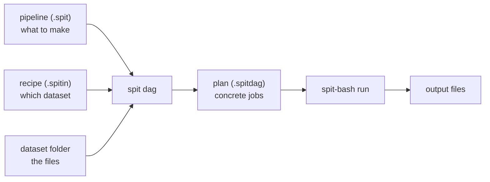

# First run

This page runs one small pipeline from start to finish: SPIT reads the pipeline and a folder of files, plans the jobs, and a runner carries them out. The pipeline takes text files in groups and writes one sorted list of unique lines for each group.

## Install

SPIT is a Rust program and its runner, `spit-bash`, is a Python package. You need a stable [Rust toolchain](https://www.rust-lang.org/tools/install) and Python 3.10 or newer, on Linux or macOS. From the root of a [SPIT checkout](https://github.com/eclnz/spit), build the compiler and install the runner in a virtual environment:

<!-- spit-doc: fragment -->

```sh
cargo build --release
export PATH="$PWD/target/release:$PATH"
python3 -m venv .venv
. .venv/bin/activate
python -m pip install ./runner
spit --version
spit-bash --help
```

`spit` plans work and never runs it. `spit-bash` runs a plan on one machine. The two share a version number, and the runner refuses a plan written by a `spit` that does not match it.

## The example pipeline

The example is the checked-in [sort and merge](https://github.com/eclnz/spit/tree/dev/examples/runnable/lines) pipeline. The dataset is three text files:

```text
input/alpha/01.txt
input/alpha/02.txt
input/beta/01.txt
```

The pipeline is `lines.spit`:

```spit
source shard : Lines [group, part]

default entities: {@key}={@value} separated "_"
default path: output/{@product}/{@entities}.txt
path shard: input/{group}/{part}.txt

operation sort_lines(input: Lines) -> Lines
command sort_lines: sort -u -o {@output} {input}
sorted = sort_lines(shard)

operation merge(items: many Lines) -> Lines
command merge: sort -m -u -o {@output} {items}
merged = merge(sorted @vary(part))
```

Read it from the top:

- `source shard : Lines [group, part]` declares a family of input files called `shard`. Each file in the family is identified by a `group` and a `part`.
- `path shard: input/{group}/{part}.txt` says where the files are. `input/alpha/01.txt` is the artifact `shard[group=alpha,part=01]`.
- `sorted = sort_lines(shard)` makes a `sorted` file from each `shard` file, using the command `sort -u -o {@output} {input}`.
- `merged = merge(sorted @vary(part))` gathers the sorted files of each `group` into one `merged` file. The `part` dimension is gone from the result, so there is one `merged` file for each group.
- `default path:` says where every file a step makes is written, and `default entities:` spells how its dimensions appear in the file name. For `sorted[group=alpha,part=01]` the path is `output/sorted/group=alpha_part=01.txt`.

A small recipe, `lines.spitin`, names the pipeline and says that the dataset is in the folder that holds the recipe:

<!-- spit-doc: recipe
--- lines.spit = examples/runnable/lines/lines.spit
-->

```spit
pipeline lines.spit
root .
```

## Preview the plan

Before anything runs, ask SPIT for the plan:

<!-- spit-doc: run -->

```sh
spit dag examples/runnable/lines/lines.spitin --counts --commands
```

<!-- spit-doc: output
spit dag examples/runnable/lines/lines.spitin --counts --commands
-->

```text
jobs  step
   3  sorted = sort_lines
   2  merged = merge
   5  total

Job 1  sort_lines
  run:    sort -u -o output/sorted/group=alpha_part=01.txt input/alpha/01.txt
Job 4  merge
  run:    sort -m -u -o output/merged/group=alpha.txt output/sorted/group=alpha_part=01.txt output/sorted/group=alpha_part=02.txt
```

The three shards give three sort jobs, and the two groups give two merge jobs. `--counts` lists the jobs for each step, and `--commands` shows each command with its file paths filled in. Nothing has run: SPIT has read the pipeline and the dataset, and it has checked that every file it expects exists.

## Run it

`spit-bash` takes the same recipe, asks SPIT for the plan, and runs the jobs. `-j 3` lets it run three jobs at once:

<!-- spit-doc: fragment -->

```sh
spit-bash run examples/runnable/lines/lines.spitin -j 3
cat examples/runnable/lines/output/merged/group=alpha.txt
cat examples/runnable/lines/output/merged/group=beta.txt
```

The three sort jobs run together, then the two merge jobs. The alpha file holds `apple`, `banana` and `pear`, one to a line, and the beta file holds `yak` and `zebra`. Run the same command again and nothing runs: every job is current, because its command and files are as the last run left them.

## How the pieces fit

The example used three kinds of file, and each answers one question:



- A **pipeline** (`.spit`) describes work for any dataset: the kinds of file, the operations, and how they connect.
- A **recipe** (`.spitin`) points the pipeline at one dataset, and says which of its files to leave out or require.
- A **plan** (`.spitdag`) lists the concrete jobs, with every path and command filled in. A runner reads the plan and nothing else.

A pipeline that gives its own dataset folder, with `root` and source paths, needs no recipe. `spit dag lines.spit` plans it directly.

## Where to go next

The sort-and-merge pipeline is small on purpose. [A weather network](walkthrough.md) reads a real analysis with 98 jobs, from the data to a figure, and the rest of the guide uses it and the other [showcase analyses](https://github.com/eclnz/spit-showcase) for its examples. Then the guide follows the same order as the first run:

1. [Artifacts](artifacts.md): how files are named, typed and located.
2. [Operations](operations.md): how a command, its checks and its resources are declared.
3. [Pipelines](pipelines.md): how steps connect, match and group artifacts.
4. [Datasets](datasets.md): how a recipe describes one dataset, with exclusions and reviews.
5. [Plans](plans.md): how to inspect a plan and find out why a job is missing.
6. [Runs](runs.md): how `spit-bash` decides what to rerun, and how to manage a run's files.

[Troubleshooting](troubleshooting.md) lists the errors you may meet, [the editor](editor.md) shows types and paths as you write, and the [glossary and cheat sheet](glossary.md) keeps the terms and syntax in one place.

Look up a command's flags in the [command line](../cli.md), and the plan's fields in the [DAG format](../spitdag.md).
