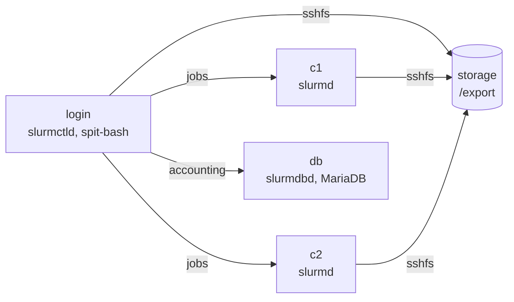

# A test cluster

A small Slurm cluster in Docker, for running spit-bash against real `sbatch`, `squeue`, `sacct` and `scancel`, and against a shared folder that each node sees late, as on an HPC system.



- **Nodes.** `login` runs the controller and is where spit-bash runs. `c1` and `c2` each have 2 CPUs and 2 GB of memory for jobs, in partition `compute`. `db` keeps accounting, so `sacct` answers; stop it to test a run without `sacct`.
- **The user.** Jobs run as `hpc`, uid 2000 on every node, which owns the shared files.
- **Memory.** Slurm enforces `--mem` with cgroups: a job over it ends `OUT_OF_MEMORY` in `sacct`.
- **The shared folder.** `login`, `c1` and `c2` mount `storage:/export` at `/shared` over sshfs. Each caches what it has seen, entries, attributes and missing files, for `CACHE_SECONDS` (30 by default), as an NFS client does with `actimeo`. So a file one node writes appears on another only once that node's cache expires. The kernel here has no NFS, which is why sshfs stands in; its caching gives the same lag. On the storage node itself, `/shared` is a link to `/export`.

## Use

Docker needs a running daemon; in a cloud session, start it with `dockerd > /tmp/dockerd.log 2>&1 &`.

```sh
cd runner/tests/cluster
docker compose up -d --build      # about 30 seconds until sinfo shows c[1-2] idle
./install.sh                      # builds SPIT, puts it, spit-bash and examples/runnable under /shared/spit
./smoke.sh                        # checks the cluster, then prints "the cluster works"
./check.py                        # runs spit-bash --executor slurm on it, then prints "spit-bash runs on the cluster"
docker compose exec -u hpc -w /shared login bash
```

On a node, `export PATH=/shared/spit/bin:/shared/spit/venv/bin:$PATH SPIT=/shared/spit/bin/spit` puts SPIT and spit-bash on the path. `install.sh` downloads the runner's wheels outside the cluster, so the nodes need no network. Run it again after changing SPIT or the runner.

`check.py` runs `examples/runnable/lines` through Slurm and judges its outputs from another node, runs every version of `examples/runnable/weather` locally and then through Slurm and compares their outputs byte for byte, retries a job its cgroup kills for memory (`pipelines/hog.spit`), retries a job Slurm stops before its time limit with twice the time (`pipelines/sleepy.spit`), runs with slurmdbd stopped, and kills a controller while its jobs run, then checks that the next one waits on them rather than submitting them again (`pipelines/slow.spit`). Name a check to run only it, as `./check.py a_new_controller_takes_over`. `../slurm-checks.sh` runs all of this with the scale test; none of it runs on GitHub.

`CACHE_SECONDS=60 docker compose up -d` sets a longer lag. `docker compose down -v` removes the cluster and its shared folder.
