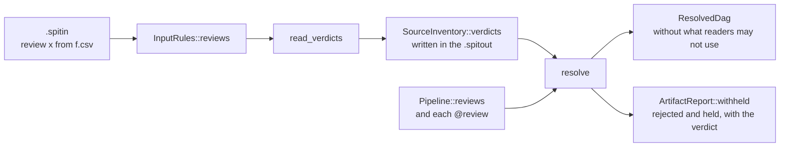

# Screens and reviews (eclnz/spit#203)

The design is in the issue. This plan splits it into pull requests, each one
complete across the repositories it touches, and records where each part
enters the code.

## Phases

1. **Reviews, with `exclude from` removed.** SPIT only; reviews need no DAG
   change, because SPIT applies them when it makes the plan.
2. **Screens.** A new `.spitdag` version, and spit-bash runs them, keeps the
   records and drops rejected members.
3. **Showcase.** `anatomical` and `functional` use screens, and a review
   example shows a person overriding one.

spit-vscode's grammar changes in the phase that adds each keyword, on a
branch of the same name.

## Phase 1: reviews

### Language

- `review name` declares a review. It takes no parameters and no command;
  a `:` after the name is an error that says so. `review:` opens a block.
- `@review(name)` goes where `@check(...)` goes: a source, an input port, an
  output. Several reviews may be attached; `@review(a, b)`.
- `default review:` in a file or stage, with `!name` to drop one, applies to
  outputs as `default check:` does.
- The recipe's `review name from file.csv` names the review's file,
  relative to the recipe's folder. A review with no line in the recipe has
  no verdicts: everything it judges is held back.
- `exclude from` is removed. Its line is an error that names the review to
  write instead.

### Data flow

- **Verdicts travel in the inventory.** The input stage reads each review's
  file and stores its rows in `SourceInventory`, and the `.spitout` writes
  them, so that a DAG made from a `.spitout` sees the same verdicts. The
  rows replace `exclude from`'s in `InputRules`.
- **The resolver applies them.** A reviewed artifact is one a review is
  attached to: of a source, of an output, or as read by an input port.
  - An artifact a verdict passes is read as usual.
  - An artifact a verdict fails, or that has none, is withheld from the
    readers the review covers. A review on a source or an output covers
    every reader of the product; a review on an input port covers that
    port.
  - The job that makes a reviewed output still runs: it makes what a person
    judges.
  - A job that reads a withheld artifact through a `one` input is left out,
    and its outputs are withheld in turn. An aggregate takes the members
    that are left, as `dag --partial` does for incomplete members, and has
    no job when none are.
  - Withheld is not incomplete: it is no error, and `spit dag` succeeds.
- **Reporting.** `spit dag` and `spit artifacts` note on stderr each
  rejection, with its reason and row, and each held artifact; and each row
  that matched no artifact, as one note per file.

### Errors

- A review file's columns are `verdict`, `reason` and dimensions. A column
  that is not a dimension of every product the review is attached to is an
  error. So is a `verdict` other than `pass` or `fail`, a row with no
  dimension value, and two rows that give one artifact different verdicts.
- `@review(x)` with no `review x` declared, and `review x from` in a recipe
  whose pipeline declares no `review x`, are errors.

### Where it enters

- Parser: `src/parser/check.rs` (the `@clause` list), `keyword.rs`,
  `declarations.rs`, `mod.rs`; the recipe's rules in `src/parser/rules.rs`;
  `split_rules` in `tests/support/mod.rs`.
- Model: `ReviewDef` and review uses beside `CheckUse` in
  `src/model/definitions.rs`; `Verdict` rows in `src/model/inputs.rs`.
- Input stage: `src/inputs/exclusions.rs` keeps the CSV reader, which moves
  to the review files; `exclude from` goes.
- Resolver: `src/resolver/mod.rs` and `matching.rs`, a withheld flag beside
  `incomplete`.
- Builtins and docs: `src/builtins.rs`, `src/builtins/docs.rs`.
- Documentation: `docs/language-reference.md` (Checks, Recipes),
  `docs/guide/recipes.md`, `docs/architecture/inputs.md` and
  `resolution.md`.
- spit-vscode: `review` keyword, `@review`, and `exclude from` gone.

### Steps

- [x] Parse `review`, `@review(...)`, `default review:` and the recipe rule (3678ffd).
- [x] Remove `exclude from`, keeping its CSV reader for review files (3678ffd).
- [x] Read review files into the inventory, and write them in the `.spitout` (3678ffd).
- [x] Withhold in the resolver; notes in `dag` and `artifacts` (3678ffd).
- [x] Documentation and examples (3678ffd). No example used `exclude from`.
- [x] spit-vscode: branch `claude/screens-and-reviews` of spit-vscode, commit f965642.

### Decisions made while building

- **Verdict rows alone go in the `.spitout`.** Rejections, held artifacts and
  unmatched rows depend on the artifacts the plan makes, outputs included,
  which exist only once jobs are resolved. `dag` and `artifacts` work them
  out from the rows and note them; `ArtifactReport::withheld` and
  `unmatched_verdicts` carry them. The `.spitdag` is unchanged.
- **The review file is checked when the input stage reads it.** The columns
  and the conflicts between rows are checked then, from the pipeline alone;
  a `.spitout` read as it is has its rows parsed, not checked again.
- **Rows conflict by what they could judge, not by what exists.** Two rows
  that agree on every dimension both give, with different verdicts, are an
  error even when no artifact has those values, so a conflict does not come
  and go with the data.
- **A review attached to nothing accepts any dimension column.** There is no
  product to check the column against; its rows match no artifact.
- **`@review(!name)` drops a default on an output only, and `default review:`
  covers outputs only**, as `default check:` does. A source or an input port
  opts out of nothing.
- **A review is imported with the operations and sources that attach it**,
  and takes `alias::` with `as`, as a check does. A recipe names such a
  review as `review lib::looked_at from file.csv`.
- **A review names one file.** A second `review name from` line is an error.
- **A verdict is exactly `pass` or `fail`**, in lower case.
- **A review whose file is missing** gives a note from `spit inputs`
  (`has no verdicts yet`) and holds back everything it judges.
- **A `one` input whose artifact is withheld leaves its job out even when
  another input has a gap**, because the job would not run in any case.
- **With several `many` inputs, a member dropped from one drops the member
  with the same `vary` values from the others**, so `{summaries}` and
  `{summaries.sub}` stay paired and no `MissingInput` follows.
- **An artifact is noted once for each step and port** that a review on an
  input port keeps it from, however many jobs of the step would read it.
- **A source a review withholds is not listed as used by no job.**
- **No hover for a review declaration.** `check --json --hovers` gains the
  words `review`, `review-clause`, `review-from` and `verdicts:` only, which
  the extension shows without a change.
- **spit-vscode's test run has four failures on `dev` too** (the tests at
  `extension.test.js` that check output-path hints and three hovers); they
  are not caused by this change.

## Phase 2: screens

To be planned in detail once phase 1 is merged: `screen` declarations and
attachments, a review overriding the screens beside it, screens in the
`.spitdag` with aggregate arguments grouped by member and each product's
record path, and spit-bash's part.
