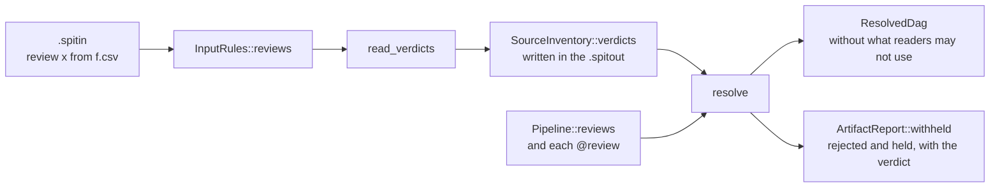
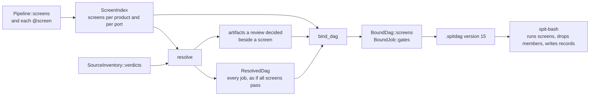

# Screens and reviews (eclnz/spit#203)

The design is in the issue. This plan splits it into pull requests, each one
complete across the repositories it touches, and records where each part
enters the code.

## Phases

1. **Reviews, with `exclude from` removed.** SPIT only; reviews need no DAG
   change, because SPIT applies them when it makes the plan.
2. **Screens.** A new `.spitdag` version, and spit-bash runs them, keeps the
   records and drops rejected members.
3. **Showcase.** `anatomical` and `functional` use screens, and a review
   example shows a person overriding one.

spit-vscode's grammar changes in the phase that adds each keyword, on a
branch of the same name.

## Phase 1: reviews

### Language

- `review name` declares a review. It takes no parameters and no command;
  a `:` after the name is an error that says so. `review:` opens a block.
- `@review(name)` goes where `@check(...)` goes: a source, an input port, an
  output. Several reviews may be attached; `@review(a, b)`.
- `default review:` in a file or stage, with `!name` to drop one, applies to
  outputs as `default check:` does.
- The recipe's `review name from file.csv` names the review's file,
  relative to the recipe's folder. A review with no line in the recipe has
  no verdicts: everything it judges is held back.
- `exclude from` is removed. Its line is an error that names the review to
  write instead.

### Data flow



- **Verdicts travel in the inventory.** The input stage reads each review's
  file and stores its rows in `SourceInventory`, and the `.spitout` writes
  them, so that a DAG made from a `.spitout` sees the same verdicts. The
  rows replace `exclude from`'s in `InputRules`.
- **The resolver applies them.** A reviewed artifact is one a review is
  attached to: of a source, of an output, or as read by an input port.
  - An artifact a verdict passes is read as usual.
  - An artifact a verdict fails, or that has none, is withheld from the
    readers the review covers. A review on a source or an output covers
    every reader of the product; a review on an input port covers that
    port.
  - The job that makes a reviewed output still runs: it makes what a person
    judges.
  - A job that reads a withheld artifact through a `one` input is left out,
    and its outputs are withheld in turn. An aggregate takes the members
    that are left, as `dag --partial` does for incomplete members, and has
    no job when none are.
  - Withheld is not incomplete: it is no error, and `spit dag` succeeds.
- **Reporting.** `spit dag` and `spit artifacts` note on stderr each
  rejection, with its reason and row, and each held artifact; and each row
  that matched no artifact, as one note per file.

### Errors

- A review file's columns are `verdict`, `reason` and dimensions. A column
  that is not a dimension of every product the review is attached to is an
  error. So is a `verdict` other than `pass` or `fail`, a row with no
  dimension value, and two rows that give one artifact different verdicts.
- `@review(x)` with no `review x` declared, and `review x from` in a recipe
  whose pipeline declares no `review x`, are errors.

### Where it enters

- Parser: `src/parser/check.rs` (the `@clause` list), `keyword.rs`,
  `declarations.rs`, `mod.rs`; the recipe's rules in `src/parser/rules.rs`;
  `split_rules` in `tests/support/mod.rs`.
- Model: `ReviewDef` and review uses beside `CheckUse` in
  `src/model/definitions.rs`; `Verdict` rows in `src/model/inputs.rs`.
- Input stage: `src/inputs/exclusions.rs` keeps the CSV reader, which moves
  to the review files; `exclude from` goes.
- Resolver: `src/resolver/mod.rs` and `matching.rs`, a withheld flag beside
  `incomplete`.
- Builtins and docs: `src/builtins.rs`, `src/builtins/docs.rs`.
- Documentation: `docs/language-reference.md` (Checks, Recipes),
  `docs/guide/recipes.md`, `docs/architecture/inputs.md` and
  `resolution.md`.
- spit-vscode: `review` keyword, `@review`, and `exclude from` gone.

### Steps

- [x] Parse `review`, `@review(...)`, `default review:` and the recipe rule (3678ffd).
- [x] Remove `exclude from`, keeping its CSV reader for review files (3678ffd).
- [x] Read review files into the inventory, and write them in the `.spitout` (3678ffd).
- [x] Withhold in the resolver; notes in `dag` and `artifacts` (3678ffd).
- [x] Documentation and examples (3678ffd). No example used `exclude from`.
- [x] spit-vscode: branch `claude/screens-and-reviews` of spit-vscode, commit f965642.

### Decisions made while building

- **Verdict rows alone go in the `.spitout`.** Rejections, held artifacts and
  unmatched rows depend on the artifacts the plan makes, outputs included,
  which exist only once jobs are resolved. `dag` and `artifacts` work them
  out from the rows and note them; `ArtifactReport::withheld` and
  `unmatched_verdicts` carry them. The `.spitdag` is unchanged.
- **The review file is checked when the input stage reads it.** The columns
  and the conflicts between rows are checked then, from the pipeline alone;
  a `.spitout` read as it is has its rows parsed, not checked again.
- **Rows conflict by what they could judge, not by what exists.** Two rows
  that agree on every dimension both give, with different verdicts, are an
  error even when no artifact has those values, so a conflict does not come
  and go with the data.
- **A review attached to nothing accepts any dimension column.** There is no
  product to check the column against; its rows match no artifact.
- **`@review(!name)` drops a default on an output only, and `default review:`
  covers outputs only**, as `default check:` does. A source or an input port
  opts out of nothing.
- **A review is imported with the operations and sources that attach it**,
  and takes `alias::` with `as`, as a check does. A recipe names such a
  review as `review lib::looked_at from file.csv`.
- **A review names one file.** A second `review name from` line is an error.
- **A verdict is exactly `pass` or `fail`**, in lower case.
- **A review whose file is missing** gives a note from `spit inputs`
  (`has no verdicts yet`) and holds back everything it judges.
- **A `one` input whose artifact is withheld leaves its job out even when
  another input has a gap**, because the job would not run in any case.
- **With several `many` inputs, a member dropped from one drops the member
  with the same `vary` values from the others**, so `{summaries}` and
  `{summaries.sub}` stay paired and no `MissingInput` follows.
- **An artifact is noted once for each step and port** that a review on an
  input port keeps it from, however many jobs of the step would read it.
- **A source a review withholds is not listed as used by no job.**
- **No hover for a review declaration.** `check --json --hovers` gains the
  words `review`, `review-clause`, `review-from` and `verdicts:` only, which
  the extension shows without a change.
- **spit-vscode's test run has four failures on `dev` too** (the tests at
  `extension.test.js` that check output-path hints and three hovers); they
  are not caused by this change.

## Phase 2: screens

Not started. The review snapshot (`review-snapshot-257-plan.md`, `.spitdag`
version 14) lands first, so screens raise the version once more. The
[decisions](#decisions-to-make-before-building) below are not settled by the
issue or the code, and each changes the `.spitdag` or what a user sees, so
they are made before the first step is built.

### What clashes

- **eclnz/spit#279, what makes a job rerun.** Screens make an aggregate's
  inputs and commands depend on verdicts found while the run goes on, which
  changes `reuse/identity.py`, `plan.py` and the state records, the code
  that theme changes. Build screens once that theme is merged.
- **eclnz/spit#271, run-start reporting.** The rejections are reported in
  `report/run_text.py` and `report/summary.py`, beside the review report.
- **`Screen` in `src/resolver/matching.rs`** is the filter a review applies
  to a port. It takes another name, such as `Withholding`, in the first
  step, so the word means one thing in the code.

### Language

`screen` is written as `check` is, and attached as `check` and `review` are:

- `screen name(params): command` declares one, with `{@path}` and its
  parameters, held to the rules `check_template` in `src/check.rs` gives a
  check. `screen:` opens a block.
- `@screen(...)` goes on a source, an input port or an output. An operation
  with a body attaches one to what its steps read and make, as
  `Invocation::checks` carries a check.
- `default screen:` in a file or stage covers outputs, with `!name` to drop
  one, and `@screen(!name)` on an output.
- `use` imports a screen with the operations and sources that attach it,
  and `as` gives it the prefix.
- `spit dag --commands` shows each as a `screen:` line under the job that
  runs it, after the `check:` lines.

A screen never changes what SPIT plans: the plan holds every job that would
run if every screen passed. SPIT's part is to say which artifact each screen
judges and what a rejection removes.

### Data flow



### A review beside a screen

A review and a screen are beside each other when they are attached at the
same place: both judge the product for every reader (a source, or an output
with its defaults), or both are on the same input port.

- A reviewed artifact a row passes is read, and the screens beside the
  review are not written for it.
- One a row fails is withheld as it is without screens.
- One no row judges is not held: the screens beside the review decide it.
  It is no target in the `.spitdag`'s `reviews`.
- Each of the first two gives a `reviewed` row in the product's record.

### `.spitdag` version 15

Three additions. A pipeline with no screen changes only in the version, the
empty fields and the `value` part.

**Top-level `screens`**, one entry per screened product, in product order:

```json
{
  "product": "summaries",
  "record": "out/measure/summaries.screens.csv",
  "dimensions": ["sub"],
  "reviewed": [{"entities": {"sub": "06"}, "screen": "usable(35)"}],
  "verdicts": [
    {"id": 1, "screen": "usable(35)", "path": "out/measure/summaries/sub=01.json",
     "port": null, "job": 3, "command": [["python3"], ["..."]]}
  ]
}
```

- `record`: the record's path under `output_root`.
- `dimensions`: the record's columns before `screen`, `verdict` and
  `reason`.
- `reviewed`: the rows a review decided, which the runner writes as they
  are.
- `verdicts`: each screen of one artifact, once, however many jobs read
  it. `id` counts from 1 across the file. `port` is
  `{"operation": O, "port": P}` for a screen on an input port and `null`
  for one on the product. `job` is the job that writes the artifact, or
  `null` for a source.

**Each job's `gates`**: what the job reads only when screens pass.

```json
"gates": [
  {"screens": [1], "paths": ["out/measure/summaries/sub=01.json"], "effect": "drop"},
  {"screens": [4], "paths": ["out/masks/sub=01.nii"], "effect": "skip"}
]
```

- `"skip"`: the path is at a `one` port. When any of `screens` rejects, the
  job does not run, and its outputs are rejected in turn.
- `"drop"`: the paths are one member of the job's `many` inputs, those the
  resolver pairs by their `@vary` values. When any of `screens` rejects,
  every path of the gate leaves `inputs`, and every argument that names one
  leaves each command. A job whose every member is dropped does not run.
- A gate lists the screens on the artifact itself and those inherited from
  the artifacts it was made from, so a runner need not walk the graph: a
  job downstream of a skipped job has a gate naming the same screens.

**A `value` part**, `{"value": "01", "of": P}`: the argument
`{summaries.sub}` gives for the member at `P` of a `many` input, which is
plain text in version 14. With it, every argument a `many` placeholder
makes holds one part naming its member, so a runner drops a member's
arguments by path and `{summaries}` and `{summaries.sub}` stay paired.

The version is the marker a runner without screens refuses: spit-bash reads
one version, and `docs/spitdag.md` says a reader that ignores `gates` lets
rejected artifacts into aggregates.

### spit-bash

- **Order.** A screen of an output runs in its job's slot, after the
  `"after"` checks. A screen of a source, or on an input port, runs before
  the first job it gates, once, as a task of its own with one core.
- **Verdict.** Exit status 0 passes. Any other status rejects, with the
  reason the last line of what the screen wrote to standard error.
- **A rejected job** is a third outcome beside done and failed: it is not
  run, its dependents with a `skip` gate on it are rejected in turn, and
  aggregates drop its member. The run's exit status counts failures only.
- **Planning.** A job behind a screen with no standing verdict is planned
  `maybe`, as a job behind a job that will run is: `settle` decides it once
  the verdicts are in. Its work is identified from the members that
  passed, so an aggregate reruns when its members change.
- **Standing verdicts.** The state file keeps, for each verdict, the stamp
  of the artifact it judged and the screen's command, as `checks_key`
  writes a check's. A verdict stands while the artifact matches the stamp,
  the command matches, and its row is in the record. A deleted record
  reruns the product's screens.
- **Records.** Written once at the end of the run, each product's rows
  sorted by entities then screen, by rename from a temporary file beside
  it: this run's verdicts, the standing ones, and `reviewed`.
- **Reports.** `plan` says how many screens will run and what stands
  rejected. `run` lists rejections by screen after its summary, as in
  `rejected 2 by usable(35): sub=04, sub=13`, with the outputs not made.
  `plan --json` gains `screens`.

### Decisions to make before building

Each has a recommendation, which the steps below assume.

1. **Where a record goes when the product's path names a dimension outside
   a group.** The issue derives the record from the path rule "with its
   dimension groups left out", which gives `out/measure/summaries` for
   `out/{@stage}/{@product}[/{@entities}]` and nothing usable for
   `out/{sub}.json`.
   - *Recommended:* drop the groups; if what is left names no dimension,
     the record is that with `.screens.csv` in place of the extension;
     otherwise it is `<product>.screens.csv` in the last folder before the
     first component that names a dimension, so `out/{sub}.json` gives
     `out/summaries.screens.csv`.
   - *Or:* require a rule of its own for the record when the product's
     gives none. More to write, and a new kind of path rule.
2. **Where a source's record goes.** Its path rule is under `root`, which
   may be read-only, and `docs/spitdag.md` tells a backend to keep what it
   writes under `output_root`.
   - *Recommended:* the same relative path under `output_root`, checked
     for collisions as an artifact's path is.
   - *Or:* under `root`, beside the data, as the issue's rule read
     literally gives.
3. **A `many` input that rejections take below `@min`.**
   - *Recommended:* the job is rejected, not failed, and the report gives
     how many passed and the minimum, as it reports a job with no member
     left.
   - *Or:* it fails, since a declared minimum was not met.
4. **A screen that cannot give a verdict**: its program cannot be started,
   or a signal kills it.
   - *Recommended:* a failure of the job that runs it, as a check's is. A
     verdict is an exit status the screen chose.
   - *Or:* a rejection with the reason `could not be run`, which keeps the
     run at exit status 0 and hides a broken installation.
5. **The reason.** The issue says "what the screen printed when it
   failed".
   - *Recommended:* the last non-empty line of standard error, with each
     run of whitespace as one space, which is what `sys.exit("...")`
     writes; `exited with status N` when there is none. Standard output
     goes to the log.
   - *Or:* every line, joined, which makes a long CSV cell of a tool's
     traceback.
6. **Outputs an earlier run made downstream of an artifact that is now
   rejected.**
   - *Recommended:* left where they are, and named in the rejection report
     as left by an earlier run. eclnz/spit#280 owns what a pipeline leaves
     on disk.
   - *Or:* removed, which eclnz/spit#273 rules out for a review's
     rejections.
7. **A screen for one call**, as in
   `table(summaries @vary(sub) @screen(usable(35)))`: the issue's open
   question.
   - *Recommended:* not in this phase. It is a new place for `@check` and
     `@review` as well, so it is an issue of its own.
   - *Or:* add the place for all three here, which widens the parser and
     spit-vscode changes.

### Where it enters

- Parser: `src/parser/check.rs` and `review.rs` (the `@clause` list and
  the blocks), `keyword.rs`, `declarations.rs`.
- Model: `ScreenDef` and screen uses beside `CheckDef` and `CheckUse` in
  `src/model/definitions.rs`; `DefaultChecks` gains its twin.
- Validation: `src/check.rs` shares `check_template` and the use checks;
  a `src/screen.rs` holds `ScreenIndex`, as `src/review.rs` holds
  `ReviewIndex`.
- Resolver: `src/resolver/matching.rs`, where a review with a screen
  beside it stops holding an unjudged artifact.
- Binding: `src/bind.rs` (`bind_checks`, `expand` for the `value` part and
  the members), `src/paths` for the record's path and its collisions.
- Writer: `src/spitdag/write.rs`; `src/render` for `--commands`.
- Runner: `schema.py`, `load.py`, `model.py`, `plan.py`,
  `execute/scheduler.py`, `execute/job.py`, `reuse/identity.py`,
  `state/store.py`, a `screens.py` for the records, `report/`.
- Documentation: `docs/language-reference.md` (a Screens section between
  Checks and Reviews, and "What a verdict does"), `docs/spitdag.md`,
  `docs/guide/`, `docs/architecture/resolution.md` and `binding.md`,
  `runner/README.md`.
- spit-vscode: `screen`, `screen:`, `@screen` and `default screen:` in
  `syntaxes/spit.tmLanguage.json`, the README's lists, `grammar.test.js`.
- `split_rules` in `tests/support/mod.rs` needs nothing: a screen has no
  recipe rule.

### Steps

One pull request in each repository, since a `.spitdag` with screens that a
runner ignores lets rejected artifacts through.

- [ ] Rename the resolver's `Screen`.
- [ ] Parse and validate `screen`, `@screen(...)` and `default screen:`;
      hovers and builtin words; spit-vscode's grammar.
- [ ] A review beside a screen: passed, failed and unjudged, in the
      resolver and the review snapshot.
- [ ] The record's path, with its collision checks.
- [ ] Bind screens, gates and the `value` part; write version 15;
      `--commands`; stored outputs.
- [ ] spit-bash: load version 15; run screens and reject jobs.
- [ ] spit-bash: drop members and identify an aggregate's work by them.
- [ ] spit-bash: standing verdicts and the records.
- [ ] spit-bash: reports, `plan --json`, exit status.
- [ ] An example under `examples/runnable` with a screen, a review beside
      it and an aggregate, in `examples/checks/coverage.json`.
- [ ] Documentation.
- [ ] Benchmark with `--old`: binding runs once per job.

## Phase 3: showcase

After phase 2 is released: spit-showcase's `anatomical/t1w_qc.spit` and
`functional/bold_qc.spit` use `screen usable(...)` in place of the `approve`
steps with `@check(usable(...))`, the `release` steps that only copy files
go, and one example shows a review beside the screen overriding it.
