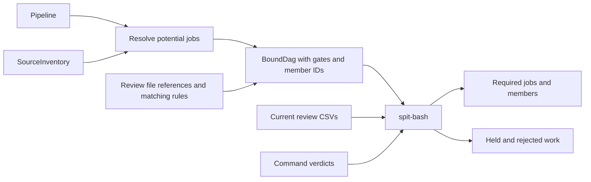

# Runner-applied gates for reviews and screens (eclnz/spit#203)

SPIT owns the potential job graph and the placement of its gates. spit-bash
owns which jobs and aggregate members are required for a particular run.
Human reviews and command screens provide verdicts to the same scheduling
logic.

## Starting point

- [x] Ship manual review syntax, CSV validation, and editor grammar
  (3678ffd, spit-vscode f965642).
- [x] Include review verdicts and provenance in the planning snapshot
  (e510e85 marks completion of the review snapshot work).

The current resolver removes jobs and aggregate members based on manual
verdicts. Move that decision to spit-bash in the same change that introduces
screens. Preserve review syntax and CSV matching and conflict rules. A
saved DAG describes the same work across review rounds. Each runner
invocation records the verdicts it used for that run.

## Compiler and runner boundary

- Resolve the potential graph independently of verdicts. Bind each gate to
  its artifact, attachment, and producer (when the artifact has one). Keep
  product-wide gates distinct from gates on a particular consumer port.
- Bind the recipe's review CSV reference and the dimensions its rows may
  match into the DAG. Preserve the recipe-relative path semantics when
  the DAG is saved or rebuilt from a `.spitout`. The runner reads and
  validates each referenced CSV once per invocation and records the rows
  it applied with file and line provenance. Review edits take effect on
  the next invocation of the same DAG, including when a previously
  missing CSV appears. Edits during an invocation wait for the next one.
- Bind a screen command to its artifact and parameters. A runner evaluates
  it only when that artifact is available and its checks have passed.
- Version the DAG contract so a runner that does not apply gates rejects
  the file. Assign the next format version from `dev` at integration.
  Update the compiler, runner, fixtures, and format docs together.
- Encode aggregate membership by input port and member identity, including
  alignment across paired inputs. Bind argument parts derived from a member
  to that identity. Cover direct paths, entity values, scalars, collections,
  and any other member-dependent parts supported by the argument format.
  A path alone cannot distinguish uses of the same artifact at different ports.
- Carry direct gate and dependency relationships. The runner propagates
  outcomes through the graph as work settles. Avoid copying all upstream
  gates into every downstream job or binding a gate as a dependency of its
  own producer.
- Preserve gaps whose relevance depends on a gate. A missing input on a
  rejected branch does not fail the run, and the same missing input on a
  required branch remains an error. Specify how the DAG carries these gaps
  before removing resolver-side withholding. Keep pipeline definition
  errors in the compiler.

## Execution semantics

1. A producer and the checks on its artifacts can run before their consumers
   are admitted. Keep checks that represent invalid artifacts or broken tools
   distinct from verdicts about whether to use sound artifacts.
2. A manual verdict overrides screens at the same attachment. Without a
   verdict, run the screens at that attachment if present. A review alone
   with no matching row holds the gated work. Gates at different attachments
   remain independent.
3. A rejected required input makes the consumer's outputs not required.
   Propagate that outcome through downstream jobs. An unresolved review
   holds a consumer and its downstream work where a verdict could still
   change what should run. Keep rejected, held, and execution failures
   distinct in planning state, statistics, and exit status.
4. For a many input, drop each rejected member and its paired members and
   arguments together. Wait for pending verdicts that can still affect the
   aggregate. Run with the final passing members if they meet its minimum.
   If rejection makes the minimum unreachable, mark the aggregate not
   required. A held member that could satisfy the minimum keeps it held.
5. Resolve membership before calculating reuse identity, checking outputs
   for reuse, or dispatching work. A verdict change can change aggregate
   identity even when all artifact bytes are unchanged. Previously produced
   outputs of work that becomes not required stay on disk and are reported
   as left by an earlier run. Issue #280 owns output cleanup.
6. Apply the same verdict and work-selection logic before local and Slurm
   dispatch. An executor receives the effective work and must not receive a
   consumer whose required gates remain unresolved.

## Running ahead of verdicts

- Add an explicit runner flag, provisionally `spit-bash run --bypass-verdicts`.
  It opens review and screen gates for that invocation, including missing
  verdicts and recorded rejections, so researchers can produce everything
  the potential DAG describes in one run. Artifact checks and ordinary
  execution failures still apply.
- Record the bypass in run metadata and the summary. Skip reading review
  CSVs and running screen commands in this mode. Preserve existing verdict
  records and never write a synthetic pass or a new cached screen verdict.
- On a normal invocation of the same DAG, enforce the current verdicts
  before reuse or dispatch. A job from a bypass run can be reused if it is
  still required and its effective work matches. An aggregate built with
  all members reruns if the passing membership differs. Outputs made by
  work that is now not required remain on disk and are left out of the
  effective graph, under the existing output cleanup policy.

## Screen declarations and records

- Use `screen name(params): command`, `screen:`, `@screen(...)`, and
  `default screen:` with the same attachment, import, and output-default
  rules as checks. A call argument can also attach a check, screen or review
  (#288). It adds to the port and product attachments and follows the
  corresponding input through composite operations. A port attachment and
  a call attachment meet at the same effective input, so a human verdict
  there can override a screen on that use.
- A normal nonzero exit rejects the artifact and records the last nonempty
  stderr line, with whitespace collapsed, or the exit status. A launch
  error or signal is an execution failure.
- Record each evaluated screen once per artifact and attachment where its
  verdict applies. Write a sorted CSV per product with its dimension
  columns, `screen`, `verdict`, and `reason`. Record passes, failures,
  and manual overrides. Give repeated attachments an unambiguous internal
  identity, including when their display labels match.
- Derive and collision-check the record path in SPIT. Drop optional
  dimension groups from the product path and replace the extension with
  `.screens.csv`. If a required dimension remains, place
  `<product>.screens.csv` in the folder before the first component that
  names a dimension. Put source records under `output_root`.
- Reuse a cached verdict only when the artifact and the effective screen
  definition and tools still match. Keep that evidence in runner state.
  The CSV is the readable record. A missing record invalidates reuse rather
  than implying a pass. Update state and publication conservatively across
  interruption and restart.

## Reporting and integration

- `spit dag` and `spit artifacts` describe potential work and where it is
  gated. Move applied verdict and unmatched-row reporting to spit-bash.
  Make the distinction clear in command help, text, and JSON.
- `spit-bash plan` may report outcomes supported by the current review CSVs
  and valid cached screen verdicts. Uncomputed screens remain pending.
  Planning runs no commands and writes no state.
- `spit-bash run` reports what passed, was rejected, is held, or failed.
  Continue independent work and exit successfully if no execution failed.
- Coordinate the breaking format and CLI change with the current version on
  `dev` and update the extension on the matching branch. Keep showcase
  adoption as a follow-up after the contract ships.

## Implementation steps

- [ ] Specify exact gate, member, and review file reference shapes. Cover gate
      scope, missing versus rejected verdicts, and argument alignment.
- [ ] Bind review gates and member identities. Stop filtering the potential
      graph by manual verdicts. Update compiler reports and DAG fixtures.
- [ ] Implement the runner's verdict and admission decisions. Cover local
      and Slurm dispatch, redo/reuse, pending reviews, and old DAG refusal.
      Test resuming from the same DAG after a review CSV changes.
- [ ] Add screen declarations, bound commands, verdict caching and CSVs.
      Update grammar, hovers, diagnostics, and the language guide.
- [ ] Test a complete workflow with a human override, a held branch, a
      rejected branch, and an aggregate using paired passing members.
- [ ] Bind and highlight call-specific attachment syntax (#288).
- [ ] Add and test the bypass flag. Run through a chain of review gates in
      one invocation, then enforce verdicts with the same DAG and check
      that excluded descendants stay out and affected aggregates rerun.
- [ ] Update the DAG contract, architecture diagrams, runnable examples,
      and reports. Run compiler, runner, editor, and relevant Slurm checks.
      Benchmark ungated pipelines and datasets against the base build.
- [ ] Complete the linked PRs and remove this plan in the final cleanup
      commit.

## Local integration state

The compiler and runner use DAG version 17. The saved DAG carries the
potential graph, review file references, scoped screen commands, and paired
collection members. The runner settles CSV verdicts before reuse and can
settle screen verdicts after a local producer's checks. A filtered collection
holds its member keys in its reuse identity, including when two candidates
have identical bytes. The editor branch highlights screens and call-specific
attachments.

Slurm can reconcile work whose verdicts are known before dispatch, including
human reviews and bypass runs. A run requiring automated screen decisions
after dispatch requires the local executor. Slurm's controller builds its
takeover and cancellation map before dispatch. Supporting those decisions
on Slurm requires carrying the final effective identities into that map
without losing ownership of outstanding tasks.

The worktrees preserve the plan for integration. The Rust suite, companion
tests, strict documentation build, usability answer keys, and ungated
compiler benchmarks pass. A fake-Slurm run resumes the same saved DAG after
a review CSV edit. The scale test and Docker cluster still need verification.
