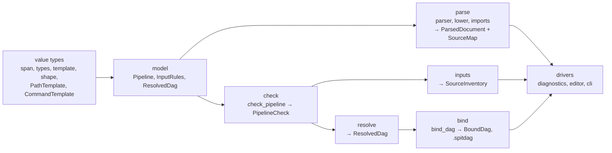

# Architecture plan: declarations, checking, vocabulary and layers

A temporary plan, per AGENTS.md "Plan files": keep it current while the work goes on, mark each step with its commit, and delete it in the last commit before the work merges. It verifies an outside audit against `dev` at `63c9c5c`; each claim below was checked in the source.

## What is wrong

### 1. A declaration kind lives in parallel structures aligned by index

- `Pipeline` holds `commands`, `resources`, `checks`, `reviews` as `Vec`s (`src/model/pipeline.rs:29-38`). Their places are separate `Vec<Place>`/`Vec<CommandPlaces>` in `SourceMap`, documented only as "in the same order" (`src/parser/source_map.rs:32-41`).
- The alignment is kept by `PipelineBuilder::add_command`, `add_resources`, `add_check` (`src/lower/mod.rs:148-161`) and `add_review` (`src/lower/reviews.rs:12-13`), and read back by bare index or `zip`: `src/editor.rs:340`, `src/resources.rs:38`, `src/check.rs:35`, `src/lower/mod.rs:406`. `src/imports/shared.rs:21` pushes to `pipeline.checks` without a place.
- Imports restate each kind three times: `apply_import` (`src/imports.rs:29-145`), `defined()` returning `[(&str, Vec<&str>); 6]` (`src/imports.rs:147`; checks, reviews and type declarations are handled separately in `apply_import`), and `Module` (`src/imports.rs:189-270`).
- **Cost.** `resources` (`e1446d4`) touched 22 files under `src/`, and 36 in all: keyword, flow, parser, source map, builder, imports, model, a validator, the recipe filter, builtins and docs, editor, binding, spitdag and render. Reviews (`3678ffd`) touched 40 under `src/`, though much of that is new resolver behaviour, not plumbing.

### 2. Checking a pipeline has no single entry

- `diagnostics::pipeline_diagnostics` (`src/diagnostics/mod.rs:501-556`) is the real driver: `collect_pipeline`, then `collect_rule_errors`, `collect_commands`, `collect_paths` and `warnings`, all sharing `PipelineCheck::poisoned: BTreeSet<String>` (`src/compile/mod.rs:56`).
- `collect_commands` also runs `collect_resources`, `collect_checks` and `collect_reviews` (`src/command/validate.rs:209-216`), so a new declaration's checks hide inside the command validator.
- `diagnose_checked_with_records` and `diagnose_checked_with_inventory` (`src/diagnostics/mod.rs:191`, `:248`) are kept in step by a comment and `tests/outputs.rs`.
- `compile()` (`src/compile/mod.rs:69`) checks only definitions; anything outside `src/diagnostics` that wants "is this pipeline valid" must know the list.
- **Cost.** A new kind of check is wired into one of four collectors, chosen by convention, and into the driver.

### 3. `ResolveError` is placed after the fact, with silent fallbacks

- `CommandError` and `PathError` are `Located<E>` at creation (`src/command/mod.rs:23`, `src/paths/template.rs:22`), which is why `check.rs`, `review.rs`, `resources.rs`, `command/validate.rs`, `paths/rules.rs` and `order.rs` import `parser::SourceMap`.
- `ResolveError` (16 variants, `src/error.rs:62-138`, not 28 as the audit said) is placed by `src/diagnostics/places.rs` from names. `pipeline_place` matches exhaustively (`:127-170`), but `step_part` (`:87`), `inventory_place` (`:192`) and `error_step` (`:236`) end in `_`, so a new variant silently gets a default place, no inventory place, or no port. (`:109` matches an `Option`, not variants.)
- `step_part` searches `pipeline.invocations` and `pipeline.operations` linearly per error (`:43-71`); cold path, but against the "find once" rule.
- **Cost.** A new `ResolveError` variant: `error.rs` (variant, `Display`), `pipeline_place` (forced by the compiler), and three `_` arms nobody is forced to revisit.

### 4. The keyword vocabulary is restated in parallel lists

- `Keyword` (25 variants), `WORDS: [_; 23]`, `BLOCKS: [_; 10]` (`src/parser/keyword.rs:7-104`).
- `STATEMENT_WORDS: [&str; 18]` (`src/parser/flow.rs:603`) differs from `WORDS`: it has `pipeline` and omits `type`, `ext`, `entities`, `skip`. The error message beside it (`flow.rs:524-527`) is a third hand-written list.
- The recipe's pipeline-only filter is a non-exhaustive `matches!` (`src/inputs/mod.rs:165-181`), and `finish_spec`'s emptiness check names six `Pipeline` fields by hand (`:224-230`). **Confirmed bug:** `default review: qc` in a `.spitin` is accepted (`Recipe valid.`), since `Keyword::Reviews` is in neither list, while `default check: foo` is rejected.
- `keyword_word` (`src/builtins.rs:106`) is an exhaustive `match`, so the compiler does flag it. `Word` indexes `DOCS: [Doc; 59]` by position (`src/builtins/docs.rs:90-95`), checked by `tests/builtin_words.rs`.
- Placeholders: `src/builtins.rs:294-300` matches `"@cores"`, `"@here"`, `"@output"` as literals although `command/validate.rs:30,34` defines `CORES` and `HERE`; `paths/template.rs:48,103` has its own spelling of `@stage`.
- **Cost.** A new keyword: `keyword.rs` (enum, `WORDS`, maybe `BLOCKS`), `flow.rs` (`STATEMENT_WORDS`, message), `inputs/mod.rs` (filter, `finish_spec`), `builtins.rs`, `builtins/docs.rs`, `split_rules` in `tests/support/mod.rs` for a recipe keyword, and spit-vscode's grammar and README. Only `keyword_word` is compiler-checked.

### 5. Module boundaries are mostly unchecked, with cycles

- `tests/architecture.rs` gives layers to `compile`, `inputs`, `resolver`, `render` and the drivers; every other top-level module (about 20 of 28) is `Shared`, free to import any other.
- Module-level cycles found by reading `crate::` paths: `imports`/`lower`, `model`/`paths`, `model`/`command`, `parser`/`command`, `parser`/`paths`, `span`/`parser` (`span.rs:238` calls `parser::strip_comment`), `error`/`model`, and `command` with `check`, `review`, `resources`. `model` imports `paths` (`model/definitions.rs:8`, `pipeline.rs:10`, `index.rs:7`, `inputs.rs:9`) and `command` (`model/definitions.rs:7`) for the value types `PathTemplate` and `CommandTemplate`. The graphify graph, refreshed for the code on 2026-11-09 (`graphify-out/GRAPH_REPORT.md`), shows `Pipeline` as the top node (209 edges) and the file cycles `imports.rs`/`lower/mod.rs` and `model/index.rs`/`paths/product.rs`; its file-level list misses the other module-level cycles.
- `bind_dag` is in `src/resolver/bind.rs` while `BoundDag` and its writer are in `src/spitdag`; the test lumps it with the resolver. `docs/architecture.md` draws parse, compile, inputs, resolve and bind, and its Boundaries list says "three steps"; the three are the command line's steps, with bind inside step 3, which the page does not say.

### 6. Path templates are interpreted twice

- Matching builds its own `Piece` list from `PathTemplate::parts` (`src/inputs/pattern.rs:18-91`); rendering walks the same parts in `paths/product.rs` and `paths/components.rs`. They agree through "Keep in step with" comments (`inputs/pattern.rs:302-306`, `paths/components.rs:35-40`, `paths/shape.rs:39,53,56`, `paths/entities.rs:70`) and no test renders a binding and matches it back.
- **Cost.** A new placeholder or shape changes the template enum, the renderer, the matcher, `is_value_character` and `Shape`.

## Target

Contracts:

- **Every top-level module has a layer**, and `tests/architecture.rs` lists the allowed edges; known back-edges sit in an explicit list that may only shrink. `model` imports only value types.
- **A declaration's place is found by its id.** `CommandId`, `ResourcesId`, `CheckId`, `ReviewId` are `u32` newtypes; `SourceMap` holds `IdVec<CheckId, Place>` and the like, written only by the builder. Places stay out of the model, as `SourceMap`'s doc requires; the index alignment becomes a typed one. One `DeclKind` enum drives `defined()`, `Module` and the conflict messages by exhaustive `match`.
- **One function checks a pipeline:** `check_pipeline(&ParsedDocument) -> PipelineCheck` runs every collector in a fixed order and returns typed errors. `src/diagnostics` only places and renders.
- **Every match over `ResolveError` or `Keyword` is exhaustive** outside tests.
- **One keyword table:** each `Keyword` has a `const fn` giving its word, whether it opens a block, where it may appear (`Pipeline`, `Recipe`, `Both`), whether it is suggested, and its `Word`. `WORDS`, `BLOCKS`, `STATEMENT_WORDS`, the flow message and the recipe filter derive from it. One placeholder table serves commands, paths and hovers.
- **One compiled path pattern:** `PathPattern` built once per product, with `render(&EntityBinding)` and `match(&str)`, owning the value-character rule.

Extension cost afterwards:

- **Keyword:** a `Keyword` variant and its table row; the compiler names `builtins.rs` and `docs.rs`; `split_rules` and spit-vscode as today.
- **Declaration kind:** model type, parser, a `DeclKind` arm (compiler-forced through imports), an id, a collector registered in `check_pipeline`.
- **Diagnostic:** a variant and its `Display`; every placement match is compiler-forced.
- **DAG field:** unchanged in count (model, bind, write, `docs/spitdag.md`, spit-bash), but all in the bind layer.

## Steps

Each step is one PR into `dev`, and keeps `spit check`/`spit dag` output and `tests/fixtures/outputs/` byte-for-byte the same unless it says otherwise. **Bench** marks a step that touches performance-related code: run `profiling/bench.py pipeline` and `dataset` with `--old` and put the result in the commit message.

1. **Layer every module in `tests/architecture.rs`.** Map each of the 28 top-level modules to a layer, and list today's back-edges (section 5) as allowed exceptions that the test reports when one disappears. Test only. *Parallel with 2, 3, 4.*
2. **Make the `ResolveError` matches in `places.rs` exhaustive.** Replace the `_` arms at `:87`, `:192`, `:236` with every variant; look steps and operations up once through `PipelineIndex`. Output unchanged. *Parallel with 1, 3, 4.*
3. **Reject every pipeline-only line in a recipe.** Replace the `matches!` at `inputs/mod.rs:165` with an exhaustive `match` on `Keyword`, and destructure `Pipeline` in `finish_spec` so a new field must be classified. **Output changes:** `default review:` in a `.spitin` becomes an error; add a test and update `docs/guide/recipes.md`. No spit-vscode change (a diagnostic, same JSON shape). *Parallel with 1, 2, 4.*
4. **Test that a rendered path matches back.** For each shape and for values needing `%` escapes, bind a path with `paths` and match it with `inputs::pattern`, getting the binding back. Test only. *Parallel with 1, 2, 3.*
5. **One keyword table and one placeholder table.** Derive `WORDS`, `BLOCKS`, `STATEMENT_WORDS`, the flow message and the recipe filter from `Keyword`; use `CORES`/`HERE` and the `PathPlaceholder` spellings in `builtins.rs`. Keep `STATEMENT_WORDS`'s membership as the table's "suggested" flag so hints stay the same. Touches the parser: **bench**. spit-vscode: none, if no word changes; say so in the PR. *After 3; parallel with 6, 7.*
6. **Typed declaration ids and `DeclKind`.** Add the ids and `IdVec` in `SourceMap`; replace the zips and `.get(index)`s (section 1) with id lookups; drive `defined()`, `Module` and the conflict loop from `DeclKind`. Touches model and lowering: **bench**. *After 1; parallel with 5, 7.*
7. **One `check_pipeline`.** Move the collector sequence out of `pipeline_diagnostics` into `compile` (or a `check` module), lift `collect_resources`/`collect_checks`/`collect_reviews` out of `collect_commands`, and share one core between the two `diagnose_checked_with_*`, taking the records as text or settled. Keep the order of the diagnostics list. **Bench** (it runs on every `check`). *After 2 and 6 (shares `check.rs`, `resources.rs`, `review.rs` with 6).*
8. **Make the model a leaf.** Move `PathTemplate`, `EntitiesFormat`, `Holder` and `CommandTemplate` into the value layer, `strip_comment` out of `parser` for `span`, and `apply_import` into `lower` (or `imports` under it). Each removed back-edge leaves step 1's list. Moves only, but in the model: **bench**. *After 6, 7.*
9. **Give binding its own layer.** Move `src/resolver/bind.rs` beside `src/spitdag`, add a `Bind` layer to the test, and rewrite `docs/architecture.md`'s Boundaries to name the stages the diagram draws, with the three command-line steps mapped onto them. No DAG format change, so no spit-bash change. **Bench** (binding). *After 8.*
10. **One compiled `PathPattern`.** Build it once per product, with `render` and `match`; replace `inputs::pattern::Piece` and the rendering in `paths/product.rs`, and retire the "Keep in step with" pairs it makes one. Step 4's test guards it. Discovery and binding are hot: **bench**, with timings in the message. *After 4 and 9.*

## Progress

Each on its own branch from `63c9c5c`, not pushed:

- [x] 1. Layers — 12c9f72 on `arch/layers`. Twelve back-edges listed: eight for step 8, three for step 7, one for step 9. Step 8 also has to remove model→error, `model/index.rs`'s use of `paths::stage_directories`, and the parser's use of `command::Stream`.
- [x] 2. Exhaustive placing — 63ddc32 on `arch/exhaustive-places`. The linear lookups stay; `PipelineIndex::producer` finds only declared products, so moving to it belongs with step 7. `inputs/coverage.rs:451` still ends in `_` over `ResolveError`.
- [x] 3. Recipe lines — 1ad7bb1 on `arch/recipe-pipeline-lines`. Only `review` was wrongly accepted, as `default review:` and inside a `default:` block.
- [x] 4. Round trip — d9cdc5c on `arch/path-roundtrip`. Two known disagreements, where two bindings render the same path: `{a}-{b}` with a value holding `-`, and `{a}{b}`.

PRs eclnz/spit#223 (1), #224 (2), #225 (3), #226 (4) are open against `dev`.

#223–#226 are merged into `dev`. Steps 5 and 6 are rebased onto it and open as eclnz/spit#236 (5) and #237 (6).

- [x] 5. Keyword and placeholder tables — d033752 on `arch/keyword-table`, PR #236. `@path` moved into `template::builtin` too, as `builtins.rs` reading it from `check` broke the layers. `Keyword::spec` gives each keyword's word, block flag, `File` and suggestion; built-in placeholder names live in `template::builtin`. The "does not start a statement" message's lists changed (the recipe list gains `path`). `keyword_word` stays in `builtins.rs`, as the parser cannot import it.
- [x] 6. Typed declaration ids and `DeclKind` — d5a8a88, cec671d on `arch/declaration-ids`, PR #237. `src/model/ids.rs`, `src/imports/kind.rs`. `DeclKind::ALL` is hand-kept: eclnz/spit#232. `tests/scaling.rs` is flaky under load: eclnz/spit#231.
#236 and #237 are merged into `dev`; steps 1–6 are all on `dev`.

- [x] 7. One `check_pipeline` — bf5a174 on `arch/check-pipeline`, PR #240. `src/validate.rs` in a new `Validate` layer above Check and Inputs; `DefinitionCheck`/`collect_definitions` in compile; `diagnose_over`; `Places` index in `places.rs`. Three `command` back-edges gone. Warnings are still found by diagnostics: eclnz/spit#238. `coverage.rs`'s `_`: eclnz/spit#239.
#240 is merged into `dev`; steps 1–7 are all on `dev`.

- [x] 8. Model as a leaf — c95c54b, c18031a, af0d7bf, c2b1eae on `arch/model-leaf`, rebased on `dev`. `span` owns comment stripping; `error` is `model/error.rs`; templates are `src/template/`; `imports` is under `lower`. `BACK_EDGES` holds only resolver→spitdag.
#241 is merged; steps 1–8 are on `dev`.

- [x] 9. Binding's own layer — 1cfa01b on `arch/bind-layer`. `src/bind.rs` in the Bind layer; `BACK_EDGES` is empty; Boundaries names the five stages.
#242 is merged; steps 1–9 are on `dev`.

- [x] 10. One compiled `PathPattern` — 42f1018, 8734c99 on `arch/path-pattern`. `src/template/pattern.rs` renders and matches; `inputs::pattern::Piece` and the separate rendering walk are gone, with four "Keep in step with" pairs. Bench: `check` 16.4 → 16.4 (pipeline), 3.5 → 3.4 and `dag` 149.1 → 149.4 (dataset); 156 example runs identical.

Work left for later is in issues: eclnz/spit#227 (two bindings rendering one path), #228 (clippy `chunks_exact`), #229 (diagnostic codes), #230 (generated spit-vscode grammar), #231 (flaky `tests/scaling.rs`), #232 (`DeclKind::ALL`), #238 (typed warnings), #239 (`coverage.rs` catch-all). Its back-edges: span→parser, model→paths, model→command, model→error, parser→paths, parser→command, lower→paths, lower→imports; plus `model/index.rs`'s `paths::stage_directories` and the parser's `command::Stream`. Also look steps and operations up once in `places.rs` (left from step 2), and fix `inputs/coverage.rs:451`'s `_` if it falls inside.

To resume: `git -C <worktree> log --oneline` shows the checkpoint commits, each of which passes the suite; continue the step from there. Step 7 needs 2 and 6; step 8 needs 6 and 7.

## Rejected or deferred

- **`Declared<T>{value, place, file}` in `Pipeline` (audit 1): rejected as stated.** `SourceMap` exists so the model carries no places, and `validate_pipeline`, imports and tests build pipelines without text. Step 6 keeps that split and makes the alignment typed.
- **Placing `ResolveError` at creation (audit 3): rejected.** `compile` runs on a `Pipeline` alone (`compile/mod.rs:64,69`, public API), so placing afterwards is the right split. The defect is the `_` arms, fixed in step 2.
- **`bind_dag` re-running `check_rules` (audit 2): keep.** `bind_dag` is public and must not trust its caller, and `check_rules` adds the inventory's paths (`paths/bind.rs:92-96`), which no earlier check sees.
- **The DAG field's route, Invocation → DagStep → BoundStep → writer (audit 5): not a defect.** Each stage owns its form, as `docs/architecture/extending.md` asks; step 9 only puts the last two in one layer.
- **Hovers from parser token spans (audit 4): deferred.** `builtin_words` re-reads lines, but step 5 removes the duplicated lists, which is where drift happens. Revisit with an issue if a hover disagrees with the parser.
- **Generating spit-vscode's grammar from the keyword table: deferred** to eclnz/spit#230; it crosses repositories and the grammar colours more than keywords.
- **Stable diagnostic codes: deferred** to eclnz/spit#229. They change `check --json` and need spit-vscode; nothing here depends on them.
- **Two bindings rendering one path** (found by step 4's test): eclnz/spit#227, a language decision outside this plan. Step 10 keeps the two known-disagreement cases until it is fixed.
- **`Pipeline` as a god struct of string-keyed tables: deferred.** Partly true (`product_paths`, `type_decls`, `SourceMap`'s `BTreeMap<String, Place>`s), but interning names is the open performance work in #37.
- **Recipes parsed through `PipelineBuilder` with `InputRules` (`lower/mod.rs:36`): deferred.** It causes the recipe bug of section 4; step 3 makes that impossible to repeat without splitting the builder.
