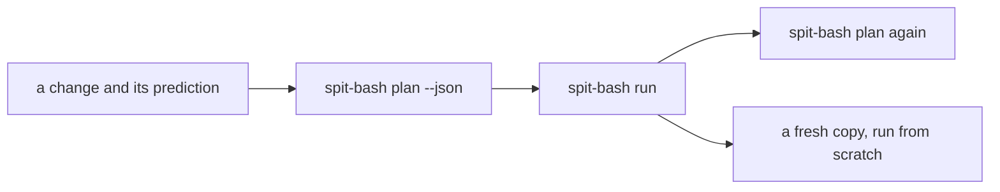

# Researcher study

Does SPIT, run by spit-bash, serve a researcher whose work doesn't go in a straight line from organising the data to writing the pipeline to running it? Data arrives late, is withdrawn, re-recorded and misnamed. The pipeline grows, changes its parameters, its formats and its paths, and is renamed. Runs are stopped, repeated, and started from DAGs saved earlier. This study runs one such history, 26 changes long, on the [spit-showcase](https://github.com/eclnz/spit-showcase) spoken digits pipeline, and checks every step.

## How it runs

The showcase's `digits/` project starts with 4 speakers × 10 digits × 3 takes. For each change in the history, five things are checked:

- **Prediction:** what the plan will run, move or check, per product, against what a careful researcher would expect. `maybe` counts as running.
- **Run:** the run exits 0.
- **Idempotence:** a second plan is all `skip`.
- **Fresh run:** a copy of the project's sources, run from scratch, gives the same bytes at every output the DAG declares.
- **Leftovers:** files under the outputs that the DAG no longer declares.

The showcase's `normalise` step dithers at random, so two runs of it differ. The study adds `sox -R` to make it repeatable, which the fresh-run check needs.

## Results

The history ran with SPIT 0.3.0 and spit-bash 0.3.0. Every run exited 0, and every second plan was all `skip`. Every iteration's outputs matched a fresh run, except iteration 15's.

| # | Change | Jobs | Ran | Verdict |
| --- | --- | --- | --- | --- |
| 0 | First run | 534 | 534 | ok |
| 1 | Rerun, nothing changed | 534 | 0 | ok |
| 2 | Every recording restored from a backup: same bytes, new times | 534 | 0 | ok |
| 3 | Takes 3 and 4 arrive | 854 | 374 | ok |
| 4 | Take 5 arrives; the run is stopped with Ctrl-C after 40 jobs, then run again | 1,014 | 174 | ok |
| 5 | One recording is re-recorded | 1,014 | 7 | ok |
| 6 | A `.DS_Store`, a Finder copy, a `.bak` and a notes file appear | 1,014 | 0 | ok, and reported |
| 7 | `4_theo_03.wav` is added beside `4_theo_3.wav` | 1,018 | 7 | accepted with no note: [finding 4](#findings) |
| 8 | `4_theo_03.wav` is deleted | 1,014 | 3 | 4 outputs left: [finding 1](#findings) |
| 9 | A new product joins all of each speaker's takes | 1,018 | 4 | ok |
| 10 | The silence threshold goes from 1% to 2% | 1,018 | 911, 107 skipped as unchanged | ok |
| 11 | Joined takes are written as FLAC, not WAV | 1,018 | 44 | 44 WAVs left: finding 1 |
| 12 | Outputs move to `results/{product}/{entities}`, with `--move-files` | 1,018 | 0, 1,018 moved | ok |
| 13 | The dimension `speaker` is renamed `voice` | 1,018 | 268, 750 moved | should all move: [finding 2](#findings) |
| 14 | Speaker yweweler withdraws | 766 | 10 | 252 outputs left: finding 1 |
| 15 | `table.py`, not declared, is edited | 766 | 0 | 13 stale tables: [finding 6](#findings) |
| 16 | `table.py` is declared as a source | 766 | 13 | ok |
| 17 | Lucas's digit 5 is lost | 741 | 3 | no error: [finding 5](#findings) |
| 18 | Lucas's digit 5 is restored | 766 | 3 | ok, and the 25 outputs left in 17 are reused |
| 19 | Operations and a stage are renamed | 766 | 0 | ok |
| 20 | Outputs move back under `out/{stage}/{product}` | 766 | 0, 766 moved | ok |
| 21 | Take 6 arrives as `seconds` is renamed `duration_s` | 886 | 166, 180 moved | ok |
| 22 | A DAG saved before the pipeline changed is run | 886 | 0 | no warning: [finding 3](#findings) |
| 23 | The recipe is run again | 886 | 512, 164 skipped as unchanged | ok |
| 24 | `out/measure/picture` is deleted by hand | 886 | 210 | ok |
| 25 | A table is annotated by hand | 886 | 1 | overwritten with no note: [finding 7](#findings) |

## Findings

SPIT and spit-bash are correct throughout: the work they do is the work the change needs, and the outputs are the ones a fresh run gives. The findings are about what the researcher is told, and about what is left behind.

1. **Outputs the pipeline no longer makes stay, and nothing reports them.** A deleted source (8), a changed extension (11), a withdrawn speaker (14) and a lost digit (17) each leave their outputs in place. By the end, 557 such files sit under `out/`. They are reused correctly when their inputs return (18). A withdrawn participant's derived data is the case that matters most.
2. **Renaming a dimension with `--move-files` reruns part of the chain** (13). All 240 `trim` jobs are moved. But 79 `normalise` jobs, theo's and yweweler's only, run with `not moved: an input is missing or changed since the run`, though their input is moved in the same run. So do the 189 jobs below them. Their 79 old outputs stay at their `speaker=` paths. A change of path rule (12, 20) and a renamed product (21) move fully. Both runs of the history gave the same numbers.
3. **A DAG saved before its pipeline changed runs with no warning** (22). spit-bash prints `all 886 jobs are current`. The DAG's `pipeline_files` record each file's git blob id.
4. **A zero-padded name becomes a new entity value** (7). `take=03` stands beside `take=3`, and theo's digit-4 summaries count the recording twice. SPIT's only sign is the source count, 241 in place of 240.
5. **A recipe can't require every combination to exist** (17). The showcase's `require [speaker] where recording count>=10` counts recordings, so a speaker with no digit 5 passes, and digit 5's table leaves them out. Its comment says every speaker says every digit.
6. **Editing a script the pipeline doesn't declare reruns nothing, and nothing says so** (15). spit-bash documents this, and declaring the script as a source fixes it (16). But the command names `../../scripts/table.py`, a file that exists, and SPIT could see that.
7. **An output edited by hand is overwritten with no note** (25). spit-bash sees `output changed` and reruns the job.
8. **A plan explains each job, not each change.** Its reasons are per job (`output missing`, `dependency will run`), and none names the sources added, changed or removed (3, 5, 7, 14, 17).
9. **Without `--move-files`, a change of paths reruns everything, and the plan doesn't offer to move.** The history doesn't run this case yet; spit-bash's plan text has no such hint.
10. **A tool that isn't deterministic goes unnoticed.** Without `sox -R`, two runs of the showcase from scratch differed in 602 of their outputs, all made from `normalise`, so every rerun of it reruns everything below it. The history doesn't run this case yet.
11. **Job logs are named by DAG position and overwritten every run**, and the run's own output isn't kept: eclnz/spit-bash#80. In an earlier, larger run of the same history, 1,634 of the 3,019 logs named no current job.
